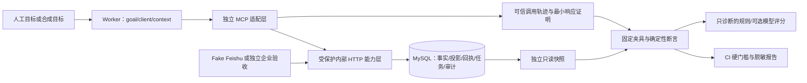

# ADR 0002：Agent 能力、可信观察与独立评测边界

- 状态：实现分支采用，统一最终审查待完成，未发布
- 日期：2026-10-16
- 需求来源：[Agent Native 需求澄清](../architecture/agent-native-requirements-clarification.md)与用户确认的三个实施计划
- 产品版本：保留 v2.8.62，代码分支提交不等于发布

## 背景与已确认边界

人工对话与 CI 需要共用组织系统能力，并准确区分请求接收、任务执行、业务提交和独立验证。用户已确认的业务边界是：飞书负责部门、人员、上下级及主部门事实；本系统只维护门店标记、编码和备注；Agent 首期范围为读取、受控门店维护和同步。生产人工 Agent 分级写入，CI 仅操作隔离 MySQL 测试库与 Fake Feishu；确定性 Evaluator 负责硬门槛，LLM 只作辅助诊断。

以上业务边界来自需求确认。下文的文件扩展、内部参数、SDK 锁定、夹具和证据实现属于控制器作出的实施判断，经过任务审查，不声称用户已逐项批准。

## 架构决定

能力层复用既有门店与同步服务，并以调用方事务保证业务变化、数据版本、审计和回执绑定。`dataset_epoch` 与 `data_version` 共同表示数据世代；Agent 应用门店预览必须同时绑定二者。幂等键按主体与环境隔离；写响应丢失后可通过 `get_operation` 观察，结果未确认不自动重写。任务自身保留 queued/running/succeeded/failed 等状态，Observation 额外表达 execution 与 fact_quality，不能把 succeeded 直接等同 verified。

终态同步回执的失败明细数与原摘要、审计在同一事务冻结，后续重试不改写原操作的任务证据；旧终态回执缺失的计数不从当前任务猜补。`accepted` 回执及 `get_sync_job` 反映当前任务；`current_dataset_epoch`、`current_data_version` 和事实质量仍明确描述当前数据集，世代不一致时不能声称历史操作已证明当前事实。

MCP 采用独立包、官方 SDK 和内部 HTTP 客户端，不依赖 ORM。入站 MCP 令牌与后端身份声明令牌分别管理。可信服务配置绑定主体、环境、运行与用例身份；模型参数和任意客户端头不能声明身份或批准。生产 L2 只有可信宿主明确确认才写入；取消、拒绝、不支持、超时默认拒绝。CI 不访问生产，即使读取也拒绝。

显式部署与默认 HTTP 工厂共用安全拒绝边界。固定 SDK 的 loopback 默认防护设置显式传给本地边界和 SDK，认证先行；被拒绝的 Host/Origin 只记录固定代码，保持原 DNS rebinding 防护。升级 SDK 时需核对这一默认配置适配。

Evaluation 的固定 YAML 是预期事实源，Worker 只拿目标、受限 MCP client 和运行身份，拿不到 fixture、expected、数据库、Fake 控制面或断言。Runner 可信边界采集真实响应与轨迹，Evaluator 通过独立只读 RR 连接核验事实、投影、版本、任务、回执及审计。不复用生产归属函数生成答案，也不把 Worker 自报 trace 或最终文本当实际证据。

读取完成必须有最终目标响应；历史真实 v1 读取可以保留，不能因后续合法 v2 写入而误失败。等价默认查询统一比较，正常分页可保留同版本目标页，但更晚相关失败或缺证明不能被旧成功掩盖。权限收窄保留来源事实与关系，质量及派生投影可以诚实变为 pending/unknown。冲突 smoke 由可信侧独立连接执行正常门店变更，必须观察到目标冲突和冲突后的新读取，不直接 seed 最终答案。

每 case 唯一测试 run_id，串行持有测试库租约并核实实际 `_test` 目标、MySQL 8.4、会话和迁移结构。截止、工具预算或不确定传输失败后撤销新调用；只有在途调用与生产 Worker 真正静止，才能取最终快照、释放自己的 lease 并清理。无法静止则保留资源并停止 suite，显式恢复不能用强删行或取消 Future 代替。

软评分固定为五个 0..1 维度，只描述规则指标。可选模型默认关闭，必须显式配置 model、provider 和 `redacted_test_only` 策略；现阶段只发送允许工具名、布尔值和行数，自由 goal/final_text 整体遮盖，异常仅记录安全状态。这个保守摘要减少语义信息，不代表真实模型理解能力已经验收。

## 结果与验收边界

本机已验证实际 MySQL 8.4.11、官方 MCP 内存协议、真实受保护 ASGI 能力 HTTP、生产同步 Worker、Fake Feishu 和六个 scripted 场景连续两轮。CLI 退出码 0/1/2 分别表示全部硬门槛通过、硬失败、配置/迁移/环境不安全；软分数永不使硬失败通过。

真实模型/Provider、企业飞书、Docker 构建及跨容器网络、生产确认入口与灰度仍需独立验收。实现分支未推送、合并或发布。数据库新表和连接设置的执行前检查、实际验证与失败恢复见[运行台账](../运行与验收.md)。

<!-- RULINGS_INVENTORY -->

## 全部实施裁决与撤回成本

C、M、E 分别对应能力观察层、MCP 适配层、Evaluation 三份实施台账。编号保留原始行号；完整路径及逐行原文保存在[持久清单](../architecture/agent-native-implementation-rulings.json)。预检简短行未写成本时，表中明确标注控制器核验的最小撤回范围。这些是实施判断，不代表用户逐项批准。

| 编号/来源行 | 中文裁决 | 判断错误时的撤回成本 | 成本依据 |
|---|---|---|---|
| C36 | 不可变数据类与稳定错误码作为共享契约的事实源。 | 调整共享模型及其消费者，重新验证序列化和错误兼容性。 | 控制器核验的最小撤回范围 |
| C37 | 回执以 actor/environment/idempotency 唯一，不改已有业务表。 | 调整新表约束、仓储及幂等并发测试。 | 控制器核验的最小撤回范围 |
| C38 | 仓储与观察服务接收调用方 Session，不自行提交。 | 调整事务入口及调用链，重新验证原子性。 | 控制器核验的最小撤回范围 |
| C39 | 内部路由只暴露固定能力 facade 方法。 | 修改内部路由与鉴权测试。 | 控制器核验的最小撤回范围 |
| C40 | 内部 HTTP 是 MCP 边界；MCP 不导入 ORM。 | 重做适配层集成和边界测试。 | 控制器核验的最小撤回范围 |
| C41 | 数据库验收只访问 _test 库；真实飞书不进入普通 CI。 | 调整测试环境与外部服务验收流程，仍需独立生产授权。 | 控制器核验的最小撤回范围 |
| C45 | 新增独立逻辑操作回执表，任务与变更日志无法唯一代表整条操作链。 | 修改一份迁移和回执仓储层。 | 原始裁决明列 |
| C46 | 保留 SyncJob 状态，新增 Observation 执行状态。 | 修改 MCP 与评测契约的兼容映射。 | 原始裁决明列 |
| C47 | 先建立内部 HTTP 能力边界，再实现 MCP。 | 调整 MCP 传输集成，补验真实生产服务边界。 | 原始裁决明列 |
| C75 | 能力 Task 4 拆为事务/异步回执集成 4A 与 facade/策略 4B；最小扩展门店、任务、Publisher 文件，原公开服务入口保留。 | 修改内部 Session 入口与异步回执集成，不变更外部 HTTP 契约。 | 原始裁决明列 |
| C76 | 生产写批准只接受可信 AgentContext.approved；模型传入 approval_token 不构成批准。 | 替换可信批准适配器，保持默认拒绝。 | 原始裁决明列 |
| C78 | CapabilityResult 内部增加不序列化的 write_operation，区分完成读取与真实写入。 | 调整内部构造分类，不变更固定 wire 字段。 | 原始裁决明列 |
| C83 | 真实 Worker 耗尽重试时终结失败回执；锁序为租约→数据状态→任务→回执，排队退避不终结。 | 修改内部失败钩子及锁序测试，不改重试策略。 | 原始裁决明列 |
| C91 | 提前增加真实 MySQL 双事务回归，验证 RR Read View；后续 Task 6 扩展同一文件。 | 移动测试归属，不改生产契约。 | 原始裁决明列 |
| C92 | Agent 门店 apply 同时绑定 expected_epoch 与 expected_version，避免恢复后版本号重用。 | 上线前调整新增输入 schema 与测试，不移除现有客户端契约。 | 原始裁决明列 |
| C94 | 新增 L0 get_operation，按 operation_id 或主体范围内幂等键观察丢失响应，禁止以重写代替查询。 | 调整一个新增读取 schema、端点与工具，回执保持兼容。 | 原始裁决明列 |
| C102 | 失败任务的 audit_ids 在原终态事务冻结，避免同 job 重试污染历史证据。 | 调整失败摘要辅助方法和兼容测试，不增加结构。 | 原始裁决明列 |
| C104 | 新 operation_receipt 表显式使用 utf8mb4_0900_as_cs，来源 ID 保留 utf8mb4_bin；显式设置并验证 MySQL 会话配置。 | 上线前修改新表选项与连接设置，不转换已有表或列。 | 原始裁决明列 |
| C106 | Docker 不可用时，在忽略目录运行官方 MySQL 8.4.11 便携实例，仅绑定回环，不安装系统服务。 | 停止并移除该一次性运行环境，保留 Compose 验收路径。 | 原始裁决明列 |
| C117 | 内部鉴权所需配置项 agent_service_token 纳入能力 Task 5 最小文件范围。 | 移动该配置项至既有配置边界，不改公共 API 或业务结构。 | 原始裁决明列 |
| C124 | 同步任务 trigger_source 使用经验证的 actor_type，完整 actor_id 保留在 requested_by/回执；重用或重试不覆盖原触发来源。 | 修改内部可选参数与回归测试，保留字段长度和完整身份审计。 | 原始裁决明列 |
| C125 | 三份依赖计划作为一次分支交付；逐任务双门禁保留，最后执行一次统一全分支评审，完成前不清理台账。 | 发布前补一次子系统全审；不删除任务门禁或统一终审。 | 原始裁决明列 |
| C128 | 增加 mysql_acceptance.py，集中实际目标预检、迁移/测试命令及子进程输出脱敏。 | 移除包装器并改用等效且经审查的命令，生产运行不依赖它。 | 原始裁决明列 |
| M41 | MCP Task 1 补 server.py，验证官方 SDK 初始化/发现与入口骨架；真实工具绑定待依赖完成后放到 Task 4。 | 调整骨架和分阶段测试，最终工具契约不变。 | 原始裁决明列 |
| M42 | 最终目录包含 get_operation 共 15 工具；门店 apply 同时要求 epoch 与 version。 | 上线前调整新增 MCP schema、目录和客户端测试。 | 原始裁决明列 |
| M43 | 锁定官方 mcp==2.2.0 及传递依赖，使用真实 SDK API。 | 更换精确 SDK 版本与传输/确认集成，重跑兼容测试。 | 原始裁决明列 |
| M44 | 入站 MCP 使用独立 ORG_MCP_SERVICE_TOKEN，后端 ORG_AGENT_SERVICE_TOKEN 仅供可信 sidecar 声明身份；两者默认拒绝。 | 调整新增凭据和部署配置，保持最小权限。 | 原始裁决明列 |
| M45 | AgentPrincipal 绑定可信服务配置/认证身份，不采信工具参数或任意客户端身份/批准头。 | 未来替换多用户身份解析器，能力与工具契约保持兼容。 | 原始裁决明列 |
| M46 | 生产 L2 采用官方 elicitation/Resolve 可信确认，只有显式 accept 且 confirmed=true 可写；拒绝、取消、不支持、超时均拒写；测试 CI 自动策略独立。 | 替换确认适配器，保留后端批准头和默认拒绝。 | 原始裁决明列 |
| M47 | 内部 HTTP 客户端增加可信、仅限关键字的 approved 参数，默认 false。 | 调整私有转发方法和测试，不改模型工具参数。 | 原始裁决明列 |
| M48 | production 环境拒绝全部 ci_agent 请求，包括读取，且在接触后端前拒绝。 | 仅在人明确授权生产 CI 读取后调整纯策略/认证边界。 | 原始裁决明列 |
| M52 | 5xx 是否可重试由内部服务显式给出，不根据 HTTP 状态推断；结果未知先观察。 | 只调整错误元数据，保留观察后再决定重试。 | 原始裁决明列 |
| M53 | Compose MCP 由显式 agent profile 启用，选择性传递环境变量，避免破坏原部署或传入数据库/飞书秘密。 | 修改 sidecar 启动命令、网络和变量接线。 | 原始裁决明列 |
| M59 | 锁定运行时 Python >=3.11,<3.14，保留现有 FastAPI/Starlette；实际验证 Python 3.13。 | 调整版本上限或另行评审框架/SDK 升级，不宣称未验证的 3.14。 | 原始裁决明列 |
| M77 | 可信内部身份头可标记 base64url-utf8 编码，以严格规范编码承载中文 actor/run/case ID；原 ASCII 调用兼容。 | 上线前调整私有身份传输及成对测试，不改存储身份或数据库。 | 原始裁决明列 |
| M87 | 安全 YAML 解析器的精确依赖从 Evaluation 提前到 Compose 解析测试，后续复用同一版本。 | 改用等效原生 CLI 校验并移除解析依赖，不改协议语义。 | 原始裁决明列 |
| M89 | 增加 health.py，限时使用带认证的官方 MCP initialize/list_tools 验证真实 /mcp 就绪。 | 替换为后续原生就绪接口，不改工具或部署凭据。 | 原始裁决明列 |
| M91 | 部署统一采用 ORG_MCP_CAPABILITY_BASE_URL 与 ORG_MCP_ACTOR_*/RUN_ID/CASE_ID 命名，避免与应用身份混淆。 | 上线前重命名新增变量并更新部署/文档测试。 | 原始裁决明列 |
| M92 | Docker 构建上下文排除 .superpowers，防止临时凭据及运行记录进入构建器。 | 调整一条排除规则及部署测试，不改运行协议。 | 原始裁决明列 |
| M100 | 既有 Dockerfile 已复制后端并安装锁定依赖；sidecar 命令/探针由 Compose 提供，本任务无需无效镜像修改。 | 后续若需要则补最小镜像指令并重验。 | 原始裁决明列 |
| E46 | 补齐 evaluation 包与五个固定模型，使用已审查的精确 YAML 依赖。 | 调整包导出、模型位置或解析器 pin，不改用例与 Runner 语义。 | 原始裁决明列 |
| E47 | 用例 ID 仅在一次 suite 加载中判重，同一文件可反复加载。 | 只调整加载器记账方式。 | 原始裁决明列 |
| E48 | Harness 独立拥有官方异步 MCP、真实受保护 HTTP 与生产同步 Worker 的生命周期。 | 合并编排模块，不改 Worker 协议或硬门槛。 | 原始裁决明列 |
| E49 | 真实 CLI 没有合法实际 MySQL _test 目标退出 2；单测只能显式注入 double，不能降级伪成功。 | 调整测试注入/CLI 配置，仍需真实 smoke。 | 原始裁决明列 |
| E50 | Alembic 仅接收已验证测试连接的短生命周期 ORG_DATABASE_URL 映射，不能仅设置 ORG_TEST_DATABASE_URL 后直接迁移。 | 修改测试迁移包装器或说明，不改生产配置。 | 原始裁决明列 |
| E51 | 禁用模型 Judge 时返回空数值分数，状态另存 metadata；软分不得覆盖硬门槛。 | 调整诊断元数据展示，不改 CI 硬门禁。 | 原始裁决明列 |
| E60 | 增加 ADR 0002 长期保存架构边界与全部台账裁决，区分人确认与实施判断。 | 修改或移除该记录，不影响运行、结构或发布状态。 | 原始裁决明列 |
| E76 | 独立只读 RR 快照、私有行比较、出站扫描放入 evidence.py；assertions 保持纯确定性。 | 合并证据读取模块，不改固定断言签名或硬语义。 | 原始裁决明列 |
| E77 | pending_protected 保留旧来源事实及成员关系，允许质量/时间与派生投影变化；派生结果另行字面断言。 | 收紧评测字段分类与预期，不授权删除来源事实。 | 原始裁决明列 |
| E83 | 读取用例必须有可信目标 MCP 成功响应，返回字段同时与固定预期和独立数据库比对，Worker 自报不能代替。 | 修改私有响应适配器、完成谓词与 Runner 集成，不改固定模型。 | 原始裁决明列 |
| E84 | 每次真实门店变化的审计都必须绑定 owning apply 回执及可信请求目标，即使 audit_required=false。 | 调整评测归因与测试，合法无变化仍允许。 | 原始裁决明列 |
| E91 | 以最终相关目标读取核验完成，保留历史响应真实性及泄露检查；晚失败不能被旧成功掩盖，正常分页同版本允许。 | 调整评测完成证据选择和回归，不改生产 API、固定模型或数据库。 | 原始裁决明列 |
| E94 | Task 5 补充封闭的 rows_unchanged 与 conflict_recovery 谓词、最小私有门店响应证明，以及目标事实质量与全局质量的独立核验；由可信 after_tool hook 通过独立 MySQL 连接调用正常 StoreAdminService.apply 制造一次并发门店变更。理由：范围外事实不可被漏验，最终数据库正确不能代替真实冲突及冲突后读取证明，pending 目标也不能因全局 partial 被假报 resolved。 | 调整评测私有证据、断言和合成用例，不改生产接口、归属算法或数据库结构。 | 原始裁决明列 |
| E96 | Task 6 可选模型诊断在 redacted_test_only 策略下只外发允许的工具名、布尔值和行数，goal 与 final_text 自由文本整体遮盖；默认不创建 provider、不联网。理由：现阶段没有已批准的员工原文外发规则，完整遮盖可避免仅靠模式匹配遗漏姓名或任意敏感原文。 | 未来在单独批准的数据策略下增加字段级脱敏及相关验证；当前诊断的语义信息量较少，不可宣称真实模型理解能力验收。 | 原始裁决明列 |
| E97 | Task 5 审查补充 preview_apply 硬谓词，必须以可信成功预览证明相同变更、世代及版本先于应用；子树夹具的部门和员工后页均加入独有事实及字面预期，并用丢页和跳过预览的真实 MySQL mutation 验证不会误过。理由：脚本执行了正确步骤不能代替 Evaluator 证明这些要求，重复数据页也不能证明范围完整。 | 调整评测封闭谓词、合成 YAML 与回归，不修改生产服务或数据库结构。 | 原始裁决明列 |
| E105 | 终态同步回执在原 finalize 事务中以当前锁读冻结 failed_detail_count 至已有 result_summary JSON，终态 get_operation 仅使用冻结任务证据；accepted 回执和 get_sync_job 继续返回当前任务，旧终态缺失的计数不从后续重试猜补。理由：原失败摘要与审计已冻结，混入后来成功的明细会使同一持久操作的证据串轮；独立 MySQL 双事务回归同时核验旧 RR 快照和重试后的稳定性。 | 调整回执 JSON 摘要、终态观察构造和相关回归，无 DDL 或生产数据回填，旧回执继续兼容。 | 原始裁决明列 |
| E106 | 将固定官方 SDK 对默认 loopback host 的有效 TransportSecuritySettings 在本地显式化，同一配置同时供 SafeTransportBoundary 与 SDK 使用，保持认证优先、421/403 和原防护。理由：仅识别显式参数会漏掉 SDK 隐式默认拒绝日志，原始恶意头可能含秘密。 | 调整默认配置适配及真实 ASGI 回归；将来升级 SDK 时核对默认值，无全局日志屏蔽或第三方包修改。 | 原始裁决明列 |

## 程序性引用完整性

以下行是标题、接口预检说明、复用裁决的实施调度或归档提醒，不算新的业务批准；原文同样保留，没有静默丢弃。

C34、C43、C82、C85、C98、C131、M20、M23、M40、M54、M62、M96、M97、M98、E45、E56、E67、E80。

合计 75 条来源行，其中 57 条实际实施裁决。
