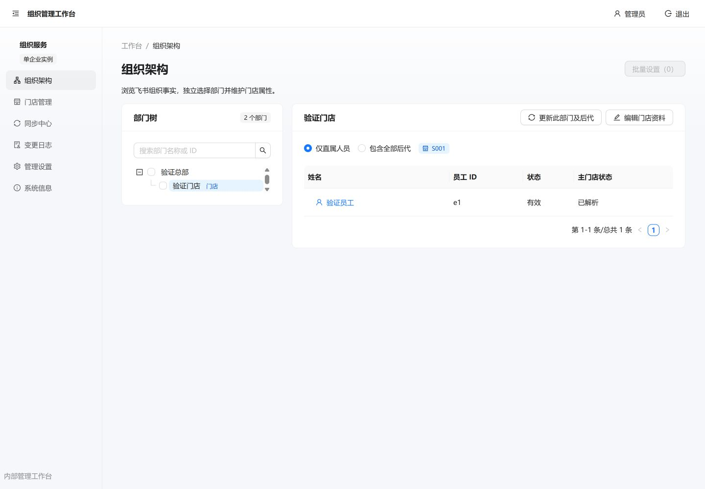
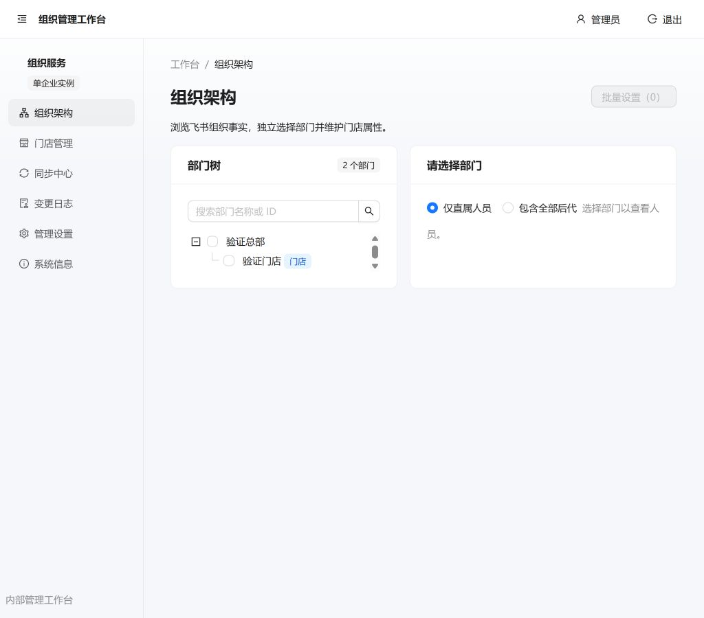
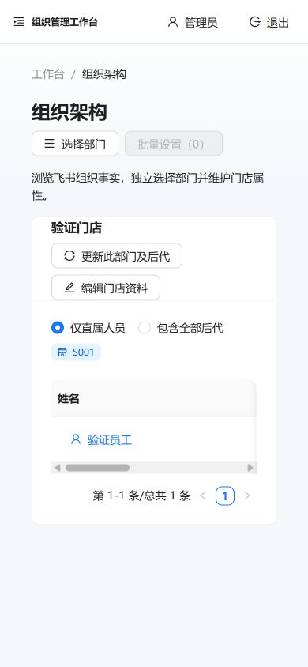

# Ant Design Pro 6 迁移实施与验收

- 日期：2026-10-25（北京时间）。
- 状态：代码迁移、本机测试及隔离 Docker 验证完成；未部署本次改动，真实企业验收待进行。
- 范围：按[迁移方案](ant-design-pro-migration-plan-2026-10-25.md)路线 A 接入 Umi Max / Utoopack、Pro 布局和七个业务页面；不涉及数据库迁移。
- 基线：`main`，`3b248ac362ada221d30b0e92e88e8704ed81316b`。实施前保存已有差异；提交携带构建必需的既有版本治理前置，保留无关同步队列及云端接入工作。

## 工程与依赖

参照 Ant Design Pro `6.0.3` [官方快照](https://github.com/ant-design/ant-design-pro/tree/52506486ea134486937043c5fb677d89bbcd07f2) 的工程约定进行业务裁剪，没有复制演示业务。锁定 Umi Max `4.7.23`、ProComponents `3.1.14-2`（预发布）、Ant Design `6.6.4`、React / React DOM `19.3.0`、dayjs `1.11.23`。Pro 工程版本与产品 `0.1.0`、ProComponents 版本分别管理。

定向 overrides 包括：Umi plugins 使用项目 ProComponents；renderer-react 使用支持 React 19 的 react-helmet-async 3；valtio 使用 use-sync-external-store 1.6；Utoopack 使用兼容其 loader 接口的 less-loader 12.3.3。没有全树覆盖 antd，也没有使用 `--force` 或 `--legacy-peer-deps`。严格 peer 安装通过，依赖树检查 `problems=[]`。Umi antd 插件按项目解析 Ant Design 6。

应用入口为小写 `src/app.tsx`，Git 索引已核对 Linux 大小写。配置路由维护六个菜单和隐藏的人员详情；应用导航使用 Umi，react-router-dom 直接依赖仅用于测试适配。Vitest 独立配置，Vite 保留为测试转换工具。

## 页面与行为

- Provider 顺序为中文 ConfigProvider、Ant App、单一 AuthGate，沿用会话、CSRF 和逐接口鉴权。
- ProLayout 使用 `mix`、`splitMenus: false`，保留完整侧栏和自定义顶栏。该版本 `side` 在桌面不渲染所需顶栏，故选择 mix。手机选择菜单会关闭导航。
- PageContainer 包含完整业务内容；组织、门店、同步、日志使用受控 ProTable，数据仍由原 hooks 读取，不启用额外 request。原分页基线保留。
- ResourceTable 适配原始 render 值，避免 Pro 默认占位转换覆盖“缺少对象 ID”等业务文案；人员详情使用 ProDescriptions，关系表保持不分页。
- 门店预览、版本冲突与草稿保护沿用现有协议；任务详情由 URL 参数驱动，支持关闭、后退、前进、刷新，活动轮询及终态刷新保留。
- 页面错误边界提供中文刷新和返回入口，导航变化后恢复；系统信息按实际能力说明配置菜单、管理员白名单和 FastAPI 同源服务。

## 验证结果

| 范围 | 本次结果 |
| --- | --- |
| 前端完整回归 | 最终 13 个文件、32 个测试通过，包含查询参数变化保留筛选状态回归 |
| 类型与生产构建 | Windows Node 24 下 setup、tsc、Utoopack build 通过 |
| 静态服务与后端版本 | pytest 7 项通过 |
| 版本规则 | Node 测试 7 项通过；`node scripts/versioning.mjs check` 通过，产品仍为 0.1.0 development |
| Ant Design lint | `issues=[]`，无跳过文件；CLI 随后缓存 rename 报 EPERM，分析结果已返回 |
| Linux 构建 | Node 24 全新严格 npm ci、类型生成、tsc、生产构建通过 |
| 完整运行镜像 | `organization-pro-migration-check` 构建通过，Python 3.13、原同源拓扑 |
| 无网络容器 HTTP | 31 个真实 JS/CSS 资源全部 200 且 MIME 正确；缺失资源及保留路径 404；SPA 深链接正常 |
| 镜像元信息 | 后端、前端 build-info.json 完全一致；未登录版本接口 401 |
| 浏览器 | 七页、人员跳转、1440/1024/390 宽度、手机部门抽屉、菜单关闭、导航 Enter 操作通过 |
| 浏览器状态 | 夹具验证 session 200/401/403/503、退出失败提示、同步详情刷新/前进/后退；最终控制台 error/warn 为空 |
| 宽表 | 390px 下文档宽度 390，表格内容宽 260、滚动宽 900，页面没有整体横向溢出 |

浏览器使用实际 dist 与本机只读合成数据夹具，不连接业务数据库；写入口返回拒绝状态以验证反馈。登录入口只核对展示，不执行真实飞书授权。测试中的 jsdom CSS/伪元素能力警告不影响断言；浏览器运行未出现对应错误。

Docker Hub 的认证域名在当前网络超时；未修改用户代理或 DNS。验证使用公开 ECR 的同一官方 Node / Python 镜像镜像源，仓库 Dockerfile 仍保持官方 Docker Hub 地址。先用全新严格安装构建前端验证层，再复用该层依赖重建最终代码和 Python 运行层；镜像验证采用 `--network none`，没有启动监督进程、同步 worker 或 migrate。

本地证据保存在忽略的 `.cache/`：`pro-frontend-tests-final.log`、`pro-system-info-tests-final.log`、`pro-final-build.log`、`pro-backend-tests-final.log`、`pro-version-tests-final.log`、`pro-dependency-tree.json`、`pro-docker-mirror-build.log`、`pro-final-docker-build.log`、`pro-docker-runtime-check.log`。这些是本机复核材料，不随提交分发。

## 审查、交付与限制

Spec / Standards 审查发现的错误恢复、表格空值语义和 Git 文件名大小写问题均已修复；前两项增加行为回归。复核发现查询参数变化会重建页面，已改为仅 pathname 变化时重置错误边界，并测试筛选状态保留。CI 已改为严格安装及完整前端测试，尚未推送或在 GitHub 运行。

开发与 setup/typecheck/build 共用 Umi 生成目录；执行类型生成或构建前先停止 dev，避免同时写入 `.umi`。各命令的元信息缓存按命令分别保存。

尚未验证本次构建在真实企业 HTTPS 环境中的飞书授权回调、实际只读业务数据和经授权的业务写入；没有替换本机或远端现有业务容器，没有执行数据库迁移。现有后端大范围回归的历史数字不作为此次迁移证据；本次后端验证限于变更相关的静态及版本边界。

回退时使用配套完整旧镜像，或撤销本次工程、依赖、入口和静态服务变更；保留实施前已有工作，不重置整个工作区。产品未发行，不增加版本或创建 tag。

## 截图

以下均为本次隔离合成数据，非真实企业数据。

