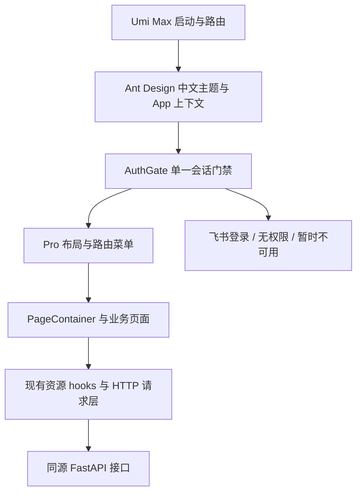

# Ant Design Pro 6 迁移设计方案

- 日期：2026-10-25（北京时间）。
- 状态：路线 A 已按用户实施指令执行；本机及隔离 Docker 验证完成，未部署。下文保留设计时基线与拟定方案，最终实现和验证边界见[实施验收记录](ant-design-pro-migration-acceptance-2026-10-25.md)。
- 项目：OrganizationalStructure。
- 核查基线：`main`，HEAD 为 `3b248ac362ad`；同时核查了当前未提交文件。
- 目标：以 Ant Design Pro 6 组织整个管理端工程、布局、导航和业务页面，并延续现有业务协议。

## 1. 建议采用的路线与待确认事项

建议采用**路线 A：以官方 Ant Design Pro 6 工程为基础，迁移至 Umi Max，再逐页迁入现有业务**。这样可以使用 Pro 的工程约定、配置式路由、布局集成和页面组织方式，后续维护也有明确的官方参照。

当前 [AGENTS.md](../../AGENTS.md) 明确要求保留 Vite、React Router，并规定变更构建与路由前需要确认。因此本方案先给出完整影响评估，待用户确认后执行。创建本方案不修改现行技术约束。

| 路线 | 实施内容 | 与目标的关系 | 本方案意见 |
| --- | --- | --- | --- |
| A：官方 Pro 工程迁移 | 以 Pro 6 官方模板为参照，使用 Umi Max 管理应用开发、构建、路由和布局；按业务裁剪模板 | 完成管理端工程迁移 | 推荐，需要批准替换现有 Vite 和应用层 React Router 集成 |
| B：现有工程接入 Pro 组件 | 保留 Vite、BrowserRouter，接入 ProLayout、PageContainer、ProTable 等 | 获得 Pro 的页面能力，工程仍是现有 Vite 应用 | 符合现行构建约束；若选择此路线，应准确称为 Pro 组件及布局接入 |

**本次待确认的问题：是否采用路线 A，允许以 Umi Max 替换 Vite 应用构建和手写 React Router 路由，并按下述范围迁移？**

路线 A 包含官方当前采用的 ProComponents 3 预发布版本，具体版本与验证门槛见第 3 节。若用户要求所有依赖均为正式版，需要重新评估时间与兼容性，不能直接使用不声明支持 Ant Design 6 的 2.x。

## 2. 当前工程盘点

以下内容来自本次文件、锁文件、Git 状态和官方资料核查。

| 项目 | 当前实际情况 | 迁移影响 |
| --- | --- | --- |
| 基础依赖 | React / React DOM `19.3.0`；Ant Design `6.6.4`；图标 `6.3.4` | 保留这些基础版本作为第一轮验证基线 |
| 应用构建与路由 | Vite `8.3.0`；React Router DOM `7.18.3` | 路线 A 改由 Umi Max 负责 |
| Pro 接入 | 锁文件中没有 `@ant-design/pro-components` | 需要新增依赖、锁文件和组件适配 |
| 页面 | 6 个主菜单、7 个业务页面 | 原有菜单和业务地址逐一迁移 |
| 认证 | `AuthGate` 读取 `/admin/auth/session`；飞书登录、管理员白名单、会话 Cookie 与 CSRF | 使用现有后端认证协议，迁移前端挂载位置 |
| 读取协议 | `data + meta`，游标、`dataset_epoch`、`data_version`，版本冲突整组重读 | 继续由现有资源读取层维护 |
| 测试 | Vitest `5.0.0`，Testing Library；配置位于 `vite.config.ts` | 将测试配置从应用构建配置中独立出来 |
| 版本信息 | Vite 插件注入 `__BUILD_INFO__` 并生成 `dist/build-info.json` | 为 Umi 重新接入同一份构建元信息 |
| 交付 | Node 24 构建，Python 3.13 镜像提供页面和 API | 保留多阶段镜像及同源部署形态，适配静态资源处理 |
| 工作区 | `main` 比当前本地 `origin/main` 引用领先 38 个提交，且有较多未提交改动 | 该计数未经 fetch，不代表远端实时状态；迁移需保护当前工作内容 |

`frontend/package.json`、锁文件、系统信息页、Vite 配置、Dockerfile、版本脚本和 CI 均有当前工作内容。实施时以这些文件的**当前内容**为基线，不能用官方模板覆盖整个目录。

实施分支建议为 `codex/ant-design-pro-migration`。开始时记录基线差异，保留既有改动；本次迁移的提交和验证证据要能单独识别。设计阶段尚未创建分支或提交。

## 3. 官方版本与兼容性设计

### 3.1 已核实的官方参照

本次读取的官方 Pro 仓库快照为 `52506486ea134486937043c5fb677d89bbcd07f2`，提交时间为 2026-10-22；该快照的 `package.json` 声明：

- Ant Design Pro 工程版本 `6.0.3`。
- `@umijs/max: ^4.7.23`。
- `@ant-design/pro-components: ^3.1.14-2`。
- `antd: ^6.6.0`、`react: ^19.2.7`，Node 要求为 `>=22.0.0`。
- 应用使用 Umi Max；当前模板配置包含 Utoopack。

这些是本次查到的工程快照与声明，不等于已验证本项目能运行，也不把仓库包版本当作用户项目的产品版本。

### 3.2 拟定第一轮锁定版本

| 依赖 | 拟定基线 | 决策与限制 |
| --- | --- | --- |
| Ant Design Pro 工程 | 上述官方快照，工程版本 `6.0.3` | 按业务裁剪，保留来源与许可证；不把它写入本项目 `version.json` |
| `@umijs/max` | `4.7.23` | 固定直接依赖版本，实际兼容性由最小工程验证 |
| `@ant-design/pro-components` | `3.1.14-2` | 与官方快照对齐的预发布版本；声明支持 `antd ^6.0.0`、React / React DOM `>=18` |
| `antd` / 图标 | `6.6.4` / `6.3.4` | 与当前项目保持同一验证基线 |
| React / React DOM | `19.3.0` | 与当前项目保持同一验证基线 |
| Node | 现有 Node 24 镜像 | 同时验证本机 Windows 和 Linux 容器 |
| TypeScript | 当前 `5.9.3` 优先 | 以 Umi 类型生成和类型检查结果确认；官方模板的版本不自动照搬 |
| Vitest / Testing Library | 现有版本优先 | 保留测试工具链，重新建立独立配置 |
| `dayjs` | 当前锁定的 `1.11.23` | 当前业务直接导入，应明确声明为直接依赖 |

2026-10-25 从 npm 官方 registry 读取到：ProComponents 的 `latest` 为 `2.8.10`，其 peer dependency 仅声明支持 `antd ^4.24.15 || ^5.11.2`；`beta` 为 `3.1.15-8`，声明支持 Ant Design 6。本轮先固定官方快照使用的 `3.1.14-2`，不随标签自动升级。是否换用其他 3.x 版本由实际验证失败及修复证据决定。

### 3.3 依赖解析必须单独检查

`@umijs/max@4.7.23` 的 npm 元数据仍声明依赖 `antd ^4.20.6`；`@umijs/plugins@4.7.23` 声明依赖 `@ant-design/pro-components ^2.0.1`。官方 Pro 快照提供了针对 `@umijs/plugins` 的 ProComponents override，使插件使用应用指定的版本。

本次也查看了该版本发布包中的 antd 插件源码：它优先解析项目声明的 antd，并显式识别 Ant Design 6。这提供了官方适配的代码依据；完整工程在本项目上的运行结果仍需验证。

迁移时按官方方式处理该覆盖关系，并用锁文件、`npm ls` 和实际页面检查验证。需要确认 Umi 的 antd 插件解析到应用的 Ant Design 6，布局和页面使用同一套组件及主题上下文。传递依赖中出现旧版本时，检查它的用途与实际打包路径；不能仅凭直接依赖、安装成功或 peer 范围就宣布兼容，也不对整个依赖树盲目强制覆盖为同一大版本。

第一阶段必须验证：安装无需 `--force` 或 `--legacy-peer-deps`；ProLayout、PageContainer、ProTable、表单、弹窗在 React 19 / Ant Design 6 下正常工作；开发热更新、生产构建和异步 chunk 加载正常。若失败，先形成具体兼容性结论，再调整候选版本。

## 4. 目标架构与模块职责

```text
frontend/
  config/
    config.ts                 Umi 配置、主题、代理、构建元信息注入
    routes.ts                 路由与菜单配置
    defaultSettings.ts        项目固定布局设置
  src/
    app.tsx                   Pro 运行时布局、Provider 和门禁挂载
    components/
      AuthGate.tsx            会话校验与登录/无权限/不可用状态
      AdminActions.tsx        管理员信息与退出操作
      ResourceState.tsx       加载、错误、空数据状态
      StoreEditor.tsx         门店预览与确认提交流程
    pages/                    原有 7 个业务页面，逐页迁移
    services/                 当前 HTTP、完整游标读取及资源 hooks
    domain.ts                 当前前端领域规则
    buildInfo.ts              保持构建元信息消费接口
    global.*                  全局基础样式；业务样式逐步收敛作用范围
  vitest.config.ts            独立测试配置
  package.json
  package-lock.json
```

以上为拟建结构；文件的具体拆分以实施时的类型与挂载验证为准。



- Umi 配置负责开发、构建、路由声明和菜单集成。
- ProLayout 负责应用框架、侧栏、页头与移动导航；PageContainer 负责页面标题、说明和操作区。
- 领域 hooks、`http.ts`、`readAll.ts` 继续负责协议、读取一致性与错误处理。
- 会话只有一个读取与失效处理来源。初期沿用 `AuthGate + SessionContext`，在 Umi 根容器或经验证的 wrapper 挂载；不再同时启动模板的另一套 `getInitialState` 用户请求。
- 当前所有业务页面均要求管理员资格，菜单由前端配置生成，后端逐接口鉴权。本轮不增加角色体系、权限数据库或后端动态菜单接口。

## 5. 信息架构与页面设计

### 5.1 导航与地址

| 地址 | 中文页面 / 菜单 | 布局设计 |
| --- | --- | --- |
| `/organization` | 组织架构 | 主菜单第 1 项；部门树与员工区 |
| `/employees/:id` | 人员详情 | 隐藏主菜单项；关联组织架构导航，提供返回操作 |
| `/stores` | 门店管理 | 主菜单第 2 项；门店表、员工抽屉、门店编辑 |
| `/sync` | 同步中心 | 主菜单第 3 项；状态、任务、事件与任务详情 |
| `/logs` | 变更日志 | 主菜单第 4 项；筛选、日志表与差异详情 |
| `/settings` | 管理设置 | 主菜单第 5 项；保留原有标签页 |
| `/system-info` | 系统信息 | 主菜单第 6 项；产品版本、运行元信息与系统说明 |

根路径和现有兜底行为继续进入组织架构。保留 `/sync?job=...` 深链接，处理浏览器前进、后退、刷新和复制地址进入页面。`/admin/auth/login`、`/admin/auth/callback` 等继续由后端处理，不能被前端路由或静态服务接管。

### 5.2 通用视觉与交互

- 保持中文管理端，品牌为“组织服务”，沿用当前蓝色主题 `#1677ff` 和圆角基线。
- 使用 Pro 侧栏布局，保留当前菜单顺序与名称；标题、说明、主操作区由 PageContainer 统一承载。
- 顶栏承载工作台标题、当前管理员入口与退出操作。当前 session 仅提供 `open_id`、`csrf_token`，不能虚构姓名、头像或角色列表。
- 侧栏显示单企业实例标识，支持桌面收起与移动端导航；选择移动端菜单后关闭导航层。
- 按 1440px、1024px、390px 宽度验证页面。组织树在窄屏仍通过“选择部门”进入；宽表在内容区域内横向滚动。
- 当前页面字段顺序、标签页位置、按钮语义和确认层级作为回归依据。移除旧布局的全局样式后，按页面核对，防止 `.ant-layout-*` 等选择器覆盖 Pro 内部结构。

### 5.3 逐页迁移范围

| 页面 | Pro 接入方式 | 必须保持的业务交互 |
| --- | --- | --- |
| 组织架构 | PageContainer；树区继续使用 Ant Design Tree；员工区使用受控 ProTable | 完整部门树、搜索保留祖先、独立选择与勾选、批量设置、子树同步、人员跳转、包含下级开关 |
| 人员详情 | PageContainer；按字段适配 ProDescriptions 与关系表 | 部门关系、全部门店、唯一主门店、解析状态与同步质量分别展示 |
| 门店管理 | PageContainer、受控 ProTable；保留业务抽屉 | 名称/编码筛选、包含失效门店、全部/主门店员工切换、编辑与预览确认 |
| 同步中心 | PageContainer、状态卡片、受控任务与事件表 | 初始化/全量更新、活动任务复用、详情轮询、终态刷新、任务及事件重试、脱敏连接信息 |
| 变更日志 | PageContainer、受控 ProTable；筛选表单按现有字段适配 | 查询/重置、来源与真实枚举、北京时间输入转 UTC ISO、修改前后差异 |
| 管理设置 | PageContainer；原有 Tabs；普通表单按需使用 ProForm | 飞书连接说明、管理员白名单、API 客户端、每日核对；保留原有标签顺序 |
| 系统信息 | PageContainer；保留版本、架构和历史展示 | `version.json` 来源、开发/发行区分、前后端构建不一致提示、后端证据缺失提示 |

ProForm / DrawerForm 按实际收益接入。门店编辑存在“预览影响 → 确认提交”的专用协议，迁移布局时先保留 `StoreEditor` 的表单与状态处理；不以通用表单的默认提交替代业务确认流程。

系统信息页的技术栈说明在迁移完成后更新为实际使用的 Pro / Umi；涉及 RBAC、动态菜单等能力说明时按真实实现核对，不能从模板或旧文案推定这些能力已经存在。

## 6. 登录、资源与业务状态

### 6.1 会话状态与转换

| 触发 / 状态 | 页面行为 | 后续转换 |
| --- | --- | --- |
| 初次校验 | 显示身份校验状态，业务页面不发起读取 | session 成功进入工作台；失败按状态显示 |
| session 401 | 显示“使用飞书登录”入口 | 链接进入后端 `/admin/auth/login` |
| session 403 | 显示“暂无管理权限”与重新检查 | 后端确认管理员资格后恢复访问 |
| 网络错误 / 503 等 | 显示当前不可用原因和重试 | 重试成功后进入工作台 |
| 已登录，业务请求返回 401/403 | 清除当前 CSRF，触发统一会话重检 | 由重检结果决定后续页面；不把全部 403 都解释成同一种原因 |
| 点击退出 | 经当前请求层调用退出接口 | 成功后回到根入口；失败保留可见反馈 |

会话 Cookie、OAuth state、HTTPS 回调与 CSRF 协议保持一致。使用 Umi 运行时接入时，需要验证 Ant Design App 上下文、SessionContext 和 Pro 布局的 Provider 顺序。官方模板的账号密码登录、示例 currentUser API 和演示 API 地址不进入业务请求链路。

### 6.2 资源与数据一致性

- `loading`、错误、空列表和成功四种资源状态继续分别表达；503 不显示为业务空数据。
- ProTable 初期采用受控 `dataSource/loading`，数据来源仍是现有资源 hooks。需要时使用其搜索/工具栏能力，但不启用另一套会与 hooks 重复发送请求的自动读取。
- 后端为游标分页；`readAll` 绑定数据世代和版本读取完整结果。前端表格的本地页码不能直接变成后端 `current/pageSize` 参数。
- 保留 `DATASET_CHANGED` 的有限重试及父子资源整组重读；新表格的刷新按钮调用相应资源或整组重载，不绕过版本协调。
- 门店预览结果绑定数据版本与表单指纹；修改内容或版本变化后必须重新预览。409 后保留草稿、更新基准、重新预览后再提交。
- `pending_verification`、`unknown`、`inconsistent` 等同步质量继续分别展示；不把它们作为删除或失效结论。
- 同步任务提交、排队、执行、采集、发布、成功与失败按后端状态展示。详情对 queued/running 每 3 秒轮询，终态刷新关联列表及健康信息，离开后清理定时器。
- 密钥仍只在创建或轮换后展示一次，关闭后不持久保存到浏览器状态存储；管理员移出和凭据操作保留原有确认。

### 6.3 表格分页基线

| 表格 | 现有行为与迁移基线 |
| --- | --- |
| 组织页员工、门店、门店员工、任务、事件、变更日志 | 客户端每页 20 条 |
| 同步任务详情对象列表 | 客户端每页 8 条 |
| 人员详情关系表、管理员白名单、API 客户端、门店变更预览 | 不分页 |
| 部门树 | 全量加载后构树，无表格分页 |

ProTable 不能凭默认值改变上述行为，也不因换组件顺带新增筛选字段、排序协议或后端分页参数。

## 7. 构建、静态服务与部署

### 7.1 开发与测试入口

- 保留 `frontend/` 工程目录及 `npm.cmd run dev/build/test` 使用入口，应用 dev/build 的内部执行命令切换为 Umi Max。
- 开发端口继续使用 `5173`，后端 `8000`；保留现有 `/admin`、`/api`、`/auth`、`/health` 代理语义。
- 拆出 `vitest.config.ts`，维护 jsdom、React 转换、路径别名及 `__BUILD_INFO__` 测试注入。Vitest 自身可能继续使用 Vite 作为测试转换依赖，需要与应用构建职责区分。
- 移除生产入口对 `main.tsx`、手写 BrowserRouter/Routes 的依赖，页面导航逐步迁为 Umi 提供的导航接口；测试通过适配边界保留可控路由环境。
- Umi 类型生成纳入安装或构建流程，保证新 checkout 执行 `npm ci` 后可以类型检查、测试与构建；Docker 中不依赖宿主机生成文件。
- `npm run build` 继续包含类型检查，不能因采用模板而失去当前 `tsc` 检查能力。

### 7.2 统一构建元信息

沿用 `scripts/versioning.mjs` 与 `ORG_BUILD_INFO_FILE` 协议：一次生成本次构建的 JSON，Umi 读取并注入 `__BUILD_INFO__`，构建完成后把同一份 JSON 放入 `dist/build-info.json`，Docker 后端继续复制同一份文件。已有 `buildInfo.ts` 和系统信息页保持其消费接口。

开发时按现有规则生成 development 元信息；正式构建必须使用对应 tag 与提交信息。开发端、生产前端和后端不能各自生成不同时间或不同 dirty 状态的元信息。前端迁移不自动提升 `version.json`；日常开发变化记录到 Unreleased，发行时按实际影响确定版本。

### 7.3 静态资源服务是必做适配

当前 `deploy/web.py` 只专门挂载 `dist/assets`，其他非保留路径统一返回 `index.html`。Umi 可能输出根级脚本、样式和异步 chunk，原实现会把这些请求错误地回退成 HTML。因此必须结合真实构建产物修改静态服务并验证，不能只检查 `/organization` 返回 200。

拟定策略：

1. 继续由 FastAPI 提供同源页面与接口；API、认证和健康路径保持后端路由优先。
2. 在静态服务中按安全的目录边界解析实际构建资源，支持输出的根级与子目录脚本、样式、字体、图片及 `build-info.json`，返回正确 Content-Type。
3. 不存在的资源文件返回 404；只有前端页面导航才做 SPA 回退。未知 API、认证等保留路径不能返回前端 HTML。
4. 验证索引缓存策略、带哈希资源和旧页面加载失效 chunk 的提示与刷新行为。
5. 以真实 `dist/index.html` 中的资源及页面懒加载请求验证整个链路，不对构建器资源名称作固定猜测。

Docker 继续输出 `frontend/dist`，运行镜像继续监听 `8000`，`mysql` / `migrate` / `app` 服务及进程监督方式沿用当前设计。本轮涉及后端的范围为静态资源适配及相关验证，不涉及数据库表结构、迁移或业务接口变更。

### 7.4 官方模板的业务裁剪

保留应用所需的布局与工程能力，移入项目自己的路由、中文品牌、主题、认证和 HTTP 层。模板里的演示 Dashboard、示例数据、账号密码登录、演示服务地址、分析统计配置、文档外链和布局设置面板按本项目需求裁剪。图表、AI 聊天、OpenAPI 代码生成、额外请求状态库等能力不因模板自带而自动纳入本轮。

Utoopack 按官方快照配置作为第一阶段候选，须验证 Windows Node 24 开发与 Linux 镜像构建。若需要调整 Umi 内部构建配置，记录具体兼容原因、产物影响及验证结果；不能在试验失败时悄悄退回另一条路线并宣称迁移完成。

## 8. 分阶段实施与验收出口

| 阶段 | 主要产物 | 完成条件 |
| --- | --- | --- |
| 0：范围与基线 | 路线确认、工作区基线、实施分支 | 用户确认路线 A；现有未提交工作得到保护 |
| 1：最小工程验证 | 锁定依赖的 Pro/Umi 最小页面、独立测试配置、元信息构建接入 | 无强制忽略依赖冲突；本机 dev、类型检查、生产 build、静态入口资源和一个异步页面可用 |
| 2：全局框架 | Pro 布局、菜单路由、单一认证门禁、主题与响应式导航 | 7 个页面可导航；登录状态正确；深链接及前进后退可用；Provider 无重复或缺失 |
| 3：业务页面迁移 | 先系统信息/人员详情，再组织/门店，随后同步/日志/设置 | 每组页面保留现有行为并通过对应回归；门店草稿与同步状态流可复核 |
| 4：交付验证 | 生产静态服务、Docker/CI、文档及 Unreleased 更新 | 前端完整测试、构建、部署相关测试、版本校验和浏览器流程通过；真实环境项独立列明 |

阶段 1 可在隔离的临时目录或经授权的工作树中验证；应用主入口在最小工程证明可行后切换。业务页面分组进入新工程，阶段完成情况单独记录。中途可以保留尚未转换的 Ant Design 业务内容，但只有所有页面和交付链路验收通过后，才将项目状态改为“已完成 Pro 迁移”。

## 9. 验证矩阵

| 范围 | 必须覆盖的证据 |
| --- | --- |
| 工程与依赖 | 新 checkout 的 `npm ci`；依赖解析与 ProComponents override；Node 24 下 dev、热更新、类型检查、生产构建 |
| 全局框架 | 所有菜单、人员详情导航归属、直接刷新、前进后退、`/sync?job=...`、根路径与兜底 |
| 身份与 HTTP | session 的成功/401/403/503/网络失败；鉴权失效后重检；写请求 Cookie 与 CSRF；退出失败反馈 |
| 组织与门店 | 跨页完整读取、树搜索、快速切换、父子版本冲突有限重试、预览规范化、草稿保留及新版本重预览 |
| 同步 | 初始化/全量入口、活动任务复用、轮询与离开清理、终态刷新、失败重试及缺失对象 ID 的不可重试状态 |
| 日志与设置 | 真实来源/枚举、查询与重置、UTC 时间参数、差异内容、管理员与客户端确认、密钥仅展示一次、北京时间计划 |
| 版本 | 前后端共用元信息；构建阶段与发行阶段；构建不一致提示；后端元信息读取失败；版本校验 |
| 静态部署 | 对真实构建的 JS/CSS/chunk/字体进行 GET 校验；缺失资源 404；未知 API 404；SPA 深链接；同一镜像构建元信息一致 |
| 视觉与浏览器 | 1440/1024/390px；组织树与导航抽屉；表格横向滚动；弹窗及表单；键盘操作与可见焦点；无新控制台错误 |
| 真实企业环境 | HTTPS 飞书登录、回调、管理员资格、实际只读页面与经授权的写入操作；明确环境、构建版本和结果 |

现有 `http`、`readAll`、`useResource`、`AuthGate`、`OrganizationPage`、`StoresPage`、`StoreEditor`、`LogsPage`、`SystemInfoPage` 的测试作为行为基线。全局工程迁移后运行前端完整测试；针对布局/路由和同步生命周期中的实际空白补充有行为价值的用例，避免只断言使用了某个 Pro 组件。

部署适配重点运行 `deploy/tests/test_web.py`，元信息运行后端产品版本测试和版本脚本测试，并执行 `node scripts/versioning.mjs check`。真实 MySQL 和飞书验证按目标环境记录，不能以 mock、旧验收或构建通过替代。

本次设计阶段未安装候选依赖、未运行迁移后的测试或构建、未连接业务数据库、未执行真实企业写入、未部署。上表是实施验收要求。

## 10. 回退与完成定义

迁移按可识别的工程、布局、页面和交付变更形成检查点。回退时撤销本次迁移的对应改动，恢复依赖锁文件、应用入口、静态服务和构建配置；保留迁移前已有的工作区内容。不能用重置整个工作区的方式处理问题。

部署后如需回退，使用此前经过验证的完整镜像，使前端资源、后端静态入口和构建元信息一起回退。本轮没有数据库迁移，不需要设计数据结构回退；线上实际操作仍按当前授权范围执行。

完成定义：

1. 应用确实使用确认后的 Pro/Umi 工程、布局和路由；候选依赖通过实际验证。
2. 7 个现有页面及核心业务状态流完成迁移，视觉和交互回归有证据。
3. 开发、测试、类型检查、生产静态资源、Docker、CI 与元信息链路一致。
4. AGENTS.md、README、部署说明、系统信息页及 Unreleased 与最终实现一致。
5. 分别说明本地验证、隔离夹具验证、真实企业环境验证和实际部署状态。

## 11. 本次证据与参考

### 本项目

- [项目约束](../../AGENTS.md)、[前端依赖](../../frontend/package.json)、[前端锁文件](../../frontend/package-lock.json)。
- [现有布局与路由](../../frontend/src/App.tsx)、[应用入口](../../frontend/src/main.tsx)、[构建与测试配置](../../frontend/vite.config.ts)。
- [认证门禁](../../frontend/src/components/AuthGate.tsx)、[HTTP 协议](../../frontend/src/services/http.ts)、[完整游标读取](../../frontend/src/services/readAll.ts)。
- [门店预览与提交](../../frontend/src/components/StoreEditor.tsx)、[同步中心](../../frontend/src/pages/SyncPage.tsx)、[系统信息](../../frontend/src/pages/SystemInfoPage.tsx)。
- [静态服务](../../deploy/web.py)、[静态服务测试](../../deploy/tests/test_web.py)、[Dockerfile](../../Dockerfile)。
- [版本规则](../versioning.md)、[版本脚本](../../scripts/versioning.mjs)、[版本 CI](../../.github/workflows/versioning.yml)。
- [既有 UI 原型与截图的说明](../ui/README.md)：其中截图为历史夹具验证，本次不视为新界面或真实企业证据。

### 官方一手来源

- [Ant Design Pro 固定快照](https://github.com/ant-design/ant-design-pro/tree/52506486ea134486937043c5fb677d89bbcd07f2)。
- [官方依赖、脚本与 overrides](https://github.com/ant-design/ant-design-pro/blob/52506486ea134486937043c5fb677d89bbcd07f2/package.json)。
- [官方 Umi 配置](https://github.com/ant-design/ant-design-pro/blob/52506486ea134486937043c5fb677d89bbcd07f2/config/config.ts)。
- [官方路由](https://github.com/ant-design/ant-design-pro/blob/52506486ea134486937043c5fb677d89bbcd07f2/config/routes.ts)、[官方运行时布局与认证示例](https://github.com/ant-design/ant-design-pro/blob/52506486ea134486937043c5fb677d89bbcd07f2/src/app.tsx)。
- [ProComponents npm 官方元数据](https://registry.npmjs.org/@ant-design%2fpro-components)、[Umi Max 4.7.23 元数据](https://registry.npmjs.org/@umijs%2fmax/4.7.23)、[Umi plugins 4.7.23 元数据](https://registry.npmjs.org/@umijs%2fplugins/4.7.23)。
- [Umi plugins 4.7.23 发布包中的 antd 插件](https://unpkg.com/@umijs/plugins@4.7.23/dist/antd.js)：核对项目依赖解析和 Ant Design 6 分支。
- 本次使用 `antd` 技能，已通过 CLI 查询 Ant Design `6.6.4` 的 Table API；ProComponents 3 的具体属性仍需在实施阶段按锁定版本逐组件核对。
