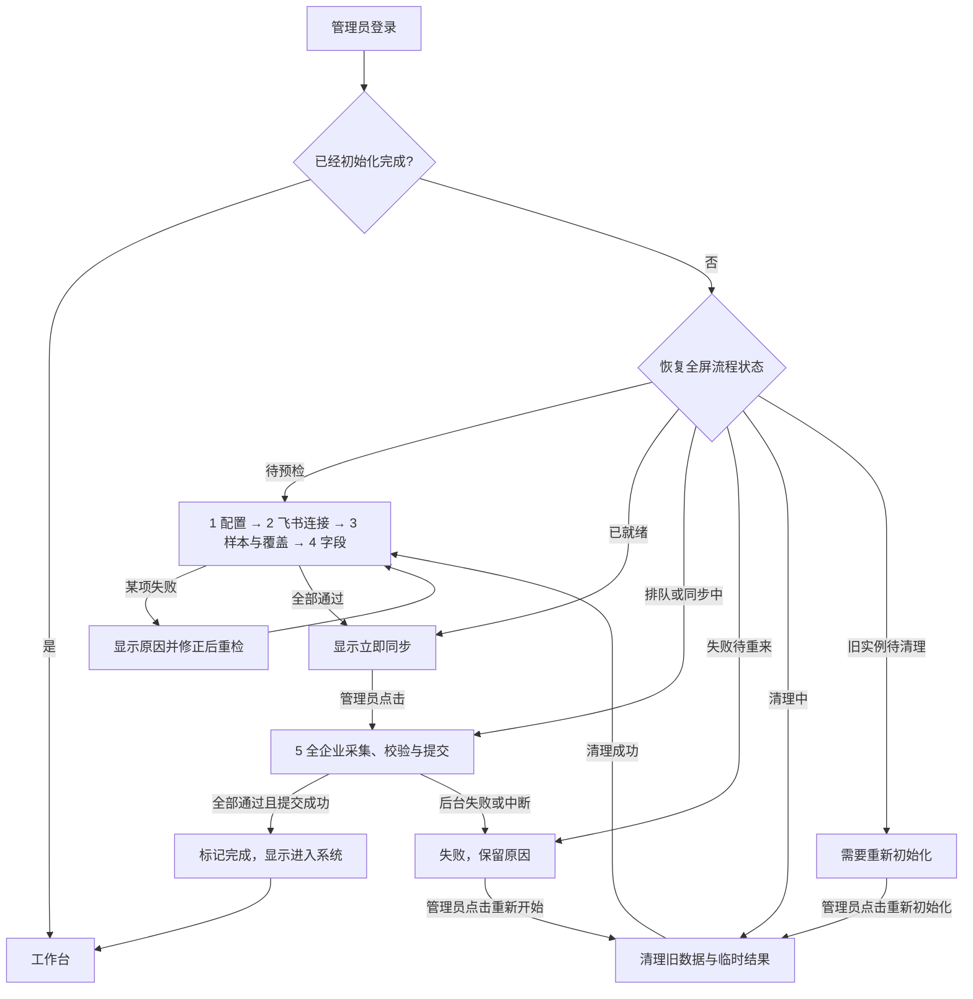

# 首次初始化向导需求澄清

> 2026-10-26 最新确认：本企业按不存在无部门人员的业务前提初始化，不再要求管理员提交全员／无部门人员名单或覆盖依据。取消该表单、预检阻断和名单精确比对；通过根部门授权检查后，递归读取部门和所有人员分页，保留字段、关系、授权变化与原子发布校验。本文以下旧版人工覆盖验收要求已被本条取代；历史依据仅保留兼容读取，不再用于采集或放行。

- 日期：2026-10-26（北京时间）。
- 项目与代码基线：OrganizationalStructure，本地 `main`。
- 状态：修订后的 Q11 已确认；功能已在本地实现，并完成隔离测试及浏览器关键流程验证。2026-10-26 按用户后续授权部署到腾讯云测试环境，迁移至 0010；目标企业初始化由用户验收，见[部署记录](initialization-cloud-deployment-2026-10-26.md)。
- 方法：按用户显式调用的 `grill-with-docs`，结合 `grilling` 与 `domain-modeling` 逐轮澄清；结论形成时同步维护领域词汇和本记录。

## 已确认规则

1. 系统未初始化时，管理员登录完成后只出现全屏初始化页面，不能进入正常工作台。
2. 非管理员不能登录。
3. 初始化之前必须实测配置、飞书连通、部门及人员读取能力、所需字段完整性；各检查项逐项显示通过状态。
4. 所有前置检查通过后，才出现“立即同步”。
5. 同步过程中显示进度。
6. 后台同步中断则本轮初始化失败，下次必须从头执行；重来时清理此前初始化留下的历史业务数据和临时结果，范围见 Q2。
7. Q1 已确认：中断以后台任务为准。刷新页面、关闭浏览器或浏览器短暂断网而后台仍运行时，允许回到页面继续查看进度；后台任务失败或服务重启导致任务终止，才判定本轮失败。
8. 必须有持久的初始化完成判据；实施复用现有 `DatasetState.initialization_status`，不新增完成字段。本次一次性数据迁移见下文；真实业务库执行另按目标环境授权。
9. Q2 已确认：初始化失败重来时，清空此前初始化留下的部门、人员、关系、门店资料（含编码、备注）及临时采集结果；保留飞书配置、管理员白名单、登录能力、失败原因和操作审计。下述 Q8 修订将同一清理边界扩展至本次旧实例重新初始化，不扩展为以后日常同步的自动清理。
10. Q3 已确认：核心 ID、名称、状态及部门关系结构必须有效；工号、职务、直属上级、员工类型、权限角色、门店属性等资料在确认具备读取权限且格式正确后，允许飞书中本来未填写。权限不足、字段不可读或格式错误阻止通过，不得把“无法读取”当作“合理空值”。
11. Q4 已确认：初始化成功必须覆盖整个飞书企业的全部部门与人员，包括没有归属部门的人员；只读取部分授权范围、无法确认全员覆盖或存在对象读取失败时，不得标记初始化成功。
12. Q5 已确认：预检阶段试读少量部门、人员样本，验证连接、读取权限和字段格式；点击“立即同步”后，读取全企业数据并逐条校验。预检通过仅表示具备开始同步的条件；全量数据也全部通过才初始化成功，全量阶段发现异常则整轮失败。
13. Q6 已确认：初始化失败后保留错误原因，不自动重启同步；由管理员手动点击“重新开始”，先按 Q2 清理此前初始化留下的业务数据和临时结果，再从第一步重跑全部预检。全部预检通过后，管理员再次点击“立即同步”。
14. Q7 已确认：全屏向导内允许管理员修正非敏感设置（例如飞书自定义字段映射）并重新检测。App Secret 等密钥继续通过部署配置维护，飞书授权范围到飞书后台调整；向导提供明确的修正指引。
15. Q8 已修订：用户在 Q11 选择调整，并明确“没有历史包袱，旧项目可以重新按这个流程重新同步一次”。据此，本次不保留旧实例的初始化豁免；无论此前是否标记完成，都纳入新的全屏向导，按 Q2 边界清理旧业务数据后，从第一步重新检查并完成全量同步一次。取消旧版本状态／旧业务数据兼容要求；配置、管理员资格、登录和审计仍保留。本次流程成功后正常使用，后续应用启动或普通发布不重复清理和初始化。
16. Q9 已确认：有部门归属的员工必须有有效的唯一主部门；主部门缺失、多个主标记或主部门不属于该员工部门关系时，阻止初始化成功并列出问题人员。真正无部门的人员允许主部门为空。
17. Q10 已确认：自动校验无法充分证明无部门人员已全部覆盖时，允许管理员核对飞书后台或企业全员名单，提供充分、可核对的依据后完成明确的人工验收；保存验收人和依据。仅勾选“已确认”不算证据，依据不足仍阻止通过；人工验收不能免除全企业完整覆盖要求。

## 向导步骤

用户已授权确定步骤数，安排五步。前四步各项依次检查，逐项显示“待检查／检查中／通过／失败”；通过项打勾，失败项显示原因及修正方式。全部前置条件由后端判定通过后，第五步才显示“立即同步”。

首次进入自动从第一步依次检查；遇到失败或需要人工依据时停在对应项，管理员修正或补充依据后点击“重新检测”。前四步通过后展示检查汇总并等待点击“立即同步”，不自动开始全量同步。

| 步骤 | 名称 | 通过依据 |
| --- | --- | --- |
| 1 | 检查配置 | 存储及迁移就绪、飞书应用与租户绑定一致、必要部署配置存在、所需字段映射与枚举配置有效；只检查密钥是否配置，不向页面返回密钥。向导可改非敏感设置，其余问题给出部署或飞书后台修正指引 |
| 2 | 测试飞书连接 | 后台实际获取有效应用凭证并调用所需通讯录接口；校验租户绑定、接口返回及根部门人员查询的全员授权条件，不以登录成功、进程存活或配置存在替代 |
| 3 | 试读部门与人员 | 试读少量真实部门及人员，验证分页、详情与关系读取；核验全企业采集路径及无部门人员覆盖依据。自动证据不足时，按 Q10 提交依据并明确人工验收 |
| 4 | 核验所需字段 | 按下表逐字段检查权限、可读性、类型及关系；区分合法空值、未返回和不可读。样本通过不替代全量逐条校验 |
| 5 | 执行全量同步 | 前四步通过后显示“立即同步”；采集全企业部门与人员、校验字段和覆盖、计算关系并提交。全部通过且最终事务提交成功才完成；失败保留原因，由管理员手动清理重来 |

## 实施前的静态代码事实

以下保留澄清阶段的旧代码核对，说明变更原因；实现后的行为见实施基线与文末记录，不以这些旧事实描述新代码。

- `backend/app/persistence/models.py` 的 `DatasetState.initialization_status` 已存在，默认值为 `pending`；本需求无需预设另加一个布尔字段。
- 当前管理员资格来自本地白名单；首次白名单管理员的登录不依赖已经同步人员。白名单外用户在 OAuth 回调被拒绝。
- `backend/app/main.py` 的登录成功回调固定跳转 `/organization`；`frontend/src/components/AuthGate.tsx` 只验证会话，没有全屏初始化门禁。
- 组织、人员与门店读取已有 `INITIALIZATION_INCOMPLETE` 门禁；管理设置等操作尚未统一限制在初始化流程内。
- `backend/app/admin/router.py` 的既有同步预检读取本地状态，并要求初始化已完成，不能直接用作本向导的初始化前飞书实测。
- `backend/app/sync/collector.py` 已采集部门与人员并报告阶段和真实计数；部分字段或对象不可读时会进入待核实状态。
- 采集阶段的计数由 `backend/app/sync/worker.py` 写入持久设置，但当前任务详情及进度接口尚未返回这些采集计数；不能把当前发布计数当作全程实时进度。
- `backend/app/sync/publisher.py` 当前在全量候选发布时设置初始化完成，允许候选覆盖未知或存在待核实项；与本轮规则不符，实施时须为未完成实例收紧成功条件。
- 当前 worker 会对采集错误自动退避重试，并将租约过期的运行任务重新排队；若有暂存候选，还会尝试恢复发布。这与本轮已确认的“后台任务中断后本轮失败、下一次从头执行”不同。
- `deploy/recovery.py` 用于备份恢复后的世代与安全状态重置，保留组织业务资料；不能直接当作本需求的清空重来入口。
- 飞书登录本身已需要基本身份配置有效；向导中的配置检查发生在管理员成功登录之后，无法替代首次部署所需的登录配置。
- 现有全企业覆盖判定依赖部署配置或人工持久验收中的“全员、无部门人员已核验”声明，再结合当前可见范围的采集结果；代码没有独立比对全企业名单。`scopes` 仅被消费为部门、人员与用户组 ID 集合；“全部当前可见数据均已读完”不能直接作为 Q4 的全企业覆盖证明。官方根部门人员查询存在全员授权校验，但尚无充分官方证据证明该列表一定包含全部无部门人员；此项按 Q10 允许有依据的人工验收。

## 官方接口核对

- 使用 `lark-openapi-explorer` 查阅公开官方文档，未调用真实企业业务 API。
- [获取部门直属用户列表](https://open.feishu.cn/document/server-docs/contact-v3/user/find_by_department.md)明确：使用 `tenant_access_token` 查询根部门 `department_id=0` 时，“会校验应用是否具有全员的通讯录权限”；无权限时报错，有权限返回根部门直属用户。[通讯录权限范围](https://open.feishu.cn/document/server-docs/contact-v3/scope/scope_authority.md)定义全员权限为拥有通讯录下所有数据的权限。因此，成功的真实根部门请求可以提供全员授权证据，但只返回根部门直属用户，仍需遍历子部门及全部分页。
- [获取通讯录授权范围](https://open.feishu.cn/document/server-docs/contact-v3/scope/list.md)明确：全员范围返回一级部门、根部门直属用户及租户下所有用户组。不得预设 `department_ids=[0]`，也不得因存在用户组就直接判定覆盖不全；须结合已经验证的全员授权和实际遍历结果判断。
- [通讯录常见问题](https://open.feishu.cn/document/server-docs/contact-v3/faqs.md)描述通过全员权限及部门遍历取得人员；尚未找到对每个 `department_ids=[]` 人员必定出现在根部门列表或授权范围人员列表的明确保证。不得把无部门人员与根部门直属人员直接等同，也不得声称只能人工验证；优先使用充分的自动证据，证据不足时使用 Q10 的人工兜底。
- [获取单个用户信息](https://open.feishu.cn/document/server-docs/contact-v3/user/get.md)说明部分字段受单独权限控制，响应缺字段不能独立证明是合法空值。[Directory 员工筛选接口](https://open.feishu.cn/document/directory-v1/employee/filter.md)提供 `row_error` 和 `field_errors`，可以区分无权限、服务错误或字段不存在，但需要相应接口及字段权限。该接口仅作为补充验证路径候选，不代表已经决定切换现有 Contact v3 集成；实际可用性须验证，无法建立字段可读证据时阻止通过。
- 已发现应用通讯录范围配置接口的官方入口，但尚未核实其完整响应、身份及权限限制；本设计不依赖它解决覆盖证明。

## 设计决策树

1. 未初始化时的入口：全屏初始化页面（已确认）。
2. 一次初始化尝试的连续性：以后端任务为准（Q1 已确认）。
   - 失败清理：Q2 已确认，按上述范围清理业务数据及临时结果，保留配置、管理员资格、登录和失败审计；边界见 [ADR 0004](../adr/0004-initialization-retry-data-boundary.md)。
   - Q6 已确认：失败后由管理员点击“重新开始”时先清理旧业务数据和临时结果，再从第一步重跑全部预检，全部通过后再次手动开始同步；不自动重启同步。
3. 初始化成功标准：所有所需前置检查与同步通过（已确认）。
   - Q3 已确认：核心字段有效；其他资料可读且格式正确时允许合理空值；权限不足、字段不可读或格式错误阻断。逐字段清单见下文实施基线。
   - Q9 已确认：有部门归属的员工必须具备有效的唯一主部门；缺失、多个主标记或与部门关系不一致时阻止初始化并列出问题人员；无部门人员允许主部门为空。
   - Q5 已确认：预检试读少量样本；“立即同步”后读取全企业并逐条校验，全部通过才初始化成功；全量阶段发现异常则整轮失败。
   - Q4 已确认：必须覆盖全企业及无部门人员；部分授权范围、覆盖无法确认或对象读取失败时不标记成功。
   - Q10 已确认：自动证明无部门人员全覆盖不足时，允许有依据的人工验收；不能仅勾选确认，也不能豁免漏人或权限失败。空结果的处理见下文实施基线。
4. 初始化状态：持久记录是否完成（已确认）。
   - Q8 已修订：旧版本已完成实例也采用本次新流程，清理旧业务数据后重新初始化一次；不设计旧初始化结果的兼容豁免。
   - 多管理员并发、检查结果失效及过程状态已随修订 Q11 整体确认。
5. 初始化期间可执行的操作：普通工作台不可进入（已确认）。
   - Q7 已确认：向导内可修改非敏感设置并重新检测；密钥经部署配置维护，飞书授权范围到飞书后台调整，由向导提供指引。
   - 退出登录、后台 API 与 Agent 操作边界已随修订 Q11 整体确认。
6. 初始化结束之后：展示成功结果并提供“进入系统”；Q8 修订后的本次切换与日常同步边界见下文。

## 实施基线：入口与操作范围

本节把 Q1—Q10 及 Q8 修订转化为实施与验收基线；整体工程边界已获修订 Q11 确认。

- 管理员沿用本系统管理员白名单定义，不把飞书企业管理员或员工权限角色直接当成本系统管理员。未初始化时，登录回调及访问任何工作台路由均进入全屏初始化向导，页面不显示工作台侧栏、菜单或工作台内容。
- 初始化期间允许管理员查看会话、退出登录、查看初始化状态／错误／进度、执行预检、维护向导内非敏感配置、提交覆盖验收、开始初始化及失败后重新开始。公开健康检查及必要 OAuth 入口保持可用，业务数据和管理操作统一受后端门禁约束。
- 普通组织／人员／门店接口、普通同步创建与重试、业务设置修改、管理员和 API 客户端管理等不属于初始化操作，不能通过直输 URL、旧接口、API Token 或 Agent 能力绕过。初始化动作只由已登录管理员发起；既有写入安全校验保持有效。
- 一个企业同时只允许一个有效初始化流程和一个活动初始化任务。重复点击或两个管理员同时点击复用当前任务；其他管理员进入同一流程并看到同一进度，不能同时清理或另起任务。
- 刷新、关闭页面、退出后重新登录均按后端持久状态恢复当前步骤或进度。只有按本次流程完成初始化后，才能正常登录工作台。
- 切换到本次流程时，一次性使旧初始化完成标记失效；不在每次启动或登录时反复重置。现有旧业务数据或任务必须经过清理与隔离，不能直接发布旧暂存结果或沿用旧预检作为本次成功依据。
- 旧实例进入全屏向导时展示“需要重新初始化”及清理范围，由管理员点击“重新初始化”，清理完成后从第一步执行五步流程。该入口用于本次流程切换；成功后不保留一个可在日常操作中随意清空全库的入口。

## 实施基线：字段检查明细

以下检查在第四步展示为独立检查项；全量同步对每条数据再次执行相同规则。部门负责人等引用有值时须能解析且符合数据模型，不通过时列出对象及原因；正常的最高负责人没有直属上级允许为空。

| 对象／检查项 | 通过规则 | 空值及错误处理 |
| --- | --- | --- |
| 部门稳定 ID、名称、状态 | ID 与请求对象一致、唯一；名称非空；删除／有效状态可读且类型正确 | 核心信息不可读、缺失或格式错误则失败；虚拟根节点按明确的根节点规则处理 |
| 部门父级与层级 | 非根部门父级可读、引用存在；无自指、无环、无断链 | 根节点无父级合理；普通部门不能用空父级掩盖读取失败 |
| 人员稳定 ID、姓名、状态 | ID 与请求对象一致、唯一；姓名非空；离职等状态可读且类型正确 | 核心信息不可读、缺失或格式错误则失败；如返回 open_id，还须格式有效且映射一致 |
| 人员部门关系 | 部门列表确实可读，引用的部门均在本轮完整部门集中 | 明确的空列表代表无部门；未返回、不可读或引用缺失不能当作无部门 |
| 人员主部门 | 有部门人员恰好一个主部门，且属于其部门关系；无部门人员无伪造主部门 | 缺失、冲突或越界则失败，不猜测第一个部门为主部门 |
| 工号、职务 | 已证明字段可读；有值时类型、格式正确 | 确认飞书未填写可为空；缺权限、不可读、格式错误则失败 |
| 人员直属上级、部门负责人 | 已证明字段可读；有值时 ID 有效且引用可解析，关系无无效自指等异常 | 业务上无上级／未设负责人允许为空；不可读不等于为空 |
| 员工类型 | 字段可读；有值时标识与配置的枚举定义一致、展示值可解析 | 合法未填写允许为空；未知或错误枚举不能静默丢弃 |
| 权限角色、门店属性 | 自定义字段映射有效、字段有读取权限；有值时类型和选项可解析 | 合法未填写允许为空；字段未配置、字段不存在、权限不足或未知格式阻止通过 |

字段可读性与字段取值分别校验，保存检查结论和错误。当前严格 Contact v3 路径要求相关字段明确返回；显式空值按规则允许，字段被省略则阻断。自定义字段另外核对定义与选项。人工覆盖验收不能替代字段读取权限检查，也未静默切换到 Directory 接口。

## 实施基线：全企业覆盖与人工依据

1. 第二步用应用身份对根部门人员接口实际请求，验证全员通讯录授权；不能以布尔部署声明或管理员裸勾选替代该请求。权限不足直接失败。
2. 第三步确认可遍历根节点、所有子部门及人员分页、授权范围中独立用户等有效人员来源；通过有限样本证明能读，不提前执行全量入库。没有子部门本身不是错误，使用真实根结构与真实人员核验；若没有任何可读取人员样本，预检停止并提示排查权限及通讯录，不把空返回当成试读成功。
3. 无部门人员优先使用充分自动证据。证据不足时，在第三步提供专门的人工验收区：记录企业及应用、来源／可复核引用或名单、核对时间、覆盖范围、核对结果、验收人及验收时间。只有“已确认”、笼统说明或无法追溯来源的数字不足以通过。
4. 人工依据须能对应本轮企业全员及无部门人员范围。全量时按实际名单核对；依据暴露出尚未发现的人员，须按稳定 ID 补充实际读取并纳入校验，不能只保存人数就宣称已同步。引用无法核对、名单差异未解决、人员不可读或仍无法证明完整时，整轮失败。
5. 覆盖证据与租户、应用、授权范围、当前初始化流程及本轮采集结果关联。相关配置／范围变化使证据失效；此前失败尝试的人工结论作为审计保留，新一轮不能直接沿用为已通过。
6. 第五步重新验证全员授权并遍历所有页、读取全部对象详情，完成部门／人员／关系逐条校验与覆盖核对。任何对象读取失败、缺权限、字段问题、主部门问题或覆盖不充分均阻止完成；不能把 `pending_verification` 当成成功。
7. 采集期间发现授权范围或名单变化，导致覆盖依据不能对应本轮结果时，本轮失败。飞书多个接口没有在本轮研究中被证实提供跨请求事务快照；不承诺仅凭一次根部门成功请求即可获得静态企业快照。

## 实施基线：状态与完成判据

复用已有 `DatasetState.initialization_status`，以 `complete` 为唯一已完成判据；完成前维持 `pending`。流程、检查结论、配置摘要及覆盖依据保存在 `SystemSetting.initialization_flow`，进度保存在 `job_progress:<job_id>`，任务与审计沿用现有模型。大型全员名单在同一事务中按字符分片，避免超出 MySQL TEXT 的 64 KiB 上限；不新增表或字段。

迁移 `0010_initialization_wizard` 一次性把旧完成标记转为 `pending`、覆盖结果转为未知；旧实例进入 `cleanup_required`，业务数据保留至管理员点击清理。新空库直接进入预检。迁移同时隔离旧活动任务、事件与 worker 租约；相同 `upgrade head` 不会再次运行已经完成的迁移。执行前检查、执行后验证及备份恢复见[切换执行说明](initialization-wizard-migration-2026-10-26.md)。尚未对业务库执行。

| 向导状态 | 可用操作／后续状态 | 完成字段 |
| --- | --- | --- |
| 旧实例待重新初始化 | 显示清理范围，点击“重新初始化”后进入清理流程 | `pending` |
| 待开始／预检中 | 从步骤 1 顺序检查；失败项修正后重新检测 | `pending` |
| 可开始同步 | 前四步及所需覆盖依据均通过，显示“立即同步” | `pending` |
| 排队／同步中 | 查看阶段与进度；不接受重复新任务或配置修改 | `pending` |
| 同步失败／中断 | 查看错误，仅可手动“重新开始”进入清理流程 | `pending` |
| 清理中 | 禁止启动任务和其他清理；成功后回步骤 1；清理失败显示原因并允许再次清理 | `pending` |
| 初始化完成 | 展示完成时间、部门／人员数量、覆盖结果，点击“进入系统” | `complete` |

- 服务端保存每项检查结果及检查时间，绑定租户、应用和配置版本；开始同步时重新核验关键配置与授权，不接受客户端传来的“已通过”代替证据。修改配置后作废受影响项及后续检查；整体配置版本不一致时禁止直接启动。
- 预检失败可以修正并重检，不需要清空业务数据；已经开始的同步失败必须走“重新开始”，不能用重检跳过清理。同步过程中冻结配置，部署配置／授权发生变化则使本轮失效。
- 发布前严格检查全部数据、覆盖证据、活动流程及任务租约。业务数据提交、初始化完成、任务成功和对应审计在同一事务内完成；任一步失败回滚，保持未完成。
- 若最终事务已经提交成功，即便浏览器没收到响应，也读取持久状态并展示成功。若 worker 在提交前终止，确认租约失效后标记本轮失败；不自动重新排队、不从暂存候选恢复初始化。旧 worker 即使恢复，也不能向新一轮写入。
- 有界的接口限流／瞬时错误处理可以发生在仍正常运行的请求内；一旦后台初始化任务已失败或终止，禁止整轮自动重启。浏览器失去连接仅显示“正在重新连接”，不能自行宣布后台失败。

## 实施基线：失败清理与旧任务隔离

- “重新开始”及本次切换的“重新初始化”只对新流程尚未完成且当前无健康活动任务的实例开放；后端加锁再次校验状态与租约，防止其他管理员刚完成初始化时发生清理。按钮旁明确提示将清除已有业务资料及门店编码／备注；点击即执行清理后从第一步开始的流程。
- 清理部门、人员、人员部门关系、门店派生关系、门店资料、门店编码占用／预留、待核实业务事实、暂存候选及采集临时结果。清理按外键顺序执行，不能留下可重新构建旧资料的临时来源。
- 保留飞书与非敏感映射配置、管理员白名单、登录能力、失败任务摘要、必要错误明细、覆盖验收历史和操作审计。历史业务审计不再作为新一轮业务数据或恢复来源。
- 旧任务处置：失败和已结束记录作为历史保留；旧流程的排队／运行任务终结并解除可执行资格。旧事件从可执行队列隔离，保留必要审计，不能在新一轮完成后重放旧任务或恢复旧候选。新流程收到的事件按流程边界保留，完成前不处理普通事件，完成后按既有机制处理；授权范围变化优先使本轮证据失效。
- 清理、失效旧流程和创建新流程须保持一致；清理中发生错误或服务终止时，不进入预检就绪，也不允许同步。再次执行清理应安全完成，不恢复半清理状态。
- 本次切换统一要求旧实例清理业务资料并按新流程重新初始化一次；不迁就旧完成标记和旧业务数据。新的初始化成功后，日常同步继续作为普通数据更新，不重复执行初始化清理；永久性日常重置入口不在本任务范围。

## 实施基线：同步进度与错误展示

- 显示当前阶段：排队、确认范围、采集部门、采集人员、全量字段／关系／覆盖校验、提交数据、完成或失败；并显示开始时间、耗时和最近更新时间。
- 实时返回真实的已发现／已读取／已校验部门与人员数量。总数未知时显示“已读取 N 人，正在发现其余人员”；总数确定后才显示相应阶段的 `N / 总数` 及百分比，不编造整体进度。
- 即便读取／校验达到总数，最终事务未提交前仍显示“正在提交”，不能显示初始化成功或整体 100%。状态和进度由后台持久化，页面重连后读取同一任务。
- 失败展示阶段、可理解的原因、受影响对象和修正方式，保留供重来后查阅；配置提示不泄露密钥或凭证。失败整轮不提供断点续传按钮，保留“重新开始”。

## 验收标准与验证安排

| 场景 | 必须观察到的行为 |
| --- | --- |
| 未初始化管理员登录、直输业务 URL | 只显示全屏向导；普通业务 API 和 Agent 路径同样被拒绝 |
| 白名单外用户登录 | 登录被拒绝，不获得初始化权限 |
| 缺配置、飞书不可达、无全员授权、字段不可读 | 对应项失败，不显示“立即同步”；修正后重新检测 |
| 样本正常，实际全量中存在错误／漏读 | 预检可通过，但本轮同步失败，完成字段仍为 `pending` |
| 合法空工号／上级等、真正无部门人员 | 权限与格式成立时允许；不把缺字段当合法空值 |
| 有部门却无唯一有效主部门 | 列出问题人员，本轮失败；不能自动猜主部门 |
| 根部门已通过全员校验且返回用户组 | 不因用户组存在直接失败；仍须证明实际全部人员覆盖 |
| 无部门覆盖自动证据不足 | 有依据、明确人工验收且实际数据一致才可通过；裸勾选、来源不足或名单差异仍阻止成功 |
| 两个管理员同时操作、重复点击 | 共享同一有效流程与任务，不能重复同步或重复清理 |
| 刷新／关闭页面／浏览器短暂断网 | 后台继续；重新进入可见真实进度 |
| worker 终止、租约失效、旧 worker 恢复 | 本轮失败，不自动恢复；旧 worker 不能发布到新流程 |
| 最终提交前失败／提交后响应丢失 | 前者不完成，后者重新读取为已完成；无半成功状态 |
| 点击重新开始、清理中再次失败 | 按边界清理，保留访问及失败审计；清理未完成不得预检就绪或启动同步 |
| 重来完成清理后 | 前四步全部重跑，历史通过标记和人工验收不能直接沿用；再次手动开始同步 |
| 旧版本已完成／未完成实例切换 | 旧完成结果失效，进入全屏向导；管理员发起后按边界清理旧数据并完成五步流程一次 |
| 本次流程完成后再次启动／普通发布 | 保持新完成状态和业务资料，不因启动、登录或同一切换重复执行而再次清理 |

实施后的验证分为后端状态／权限／并发／故障测试、前端向导与重连流程测试、隔离 MySQL 事务及外键清理验证、浏览器关键流程验收。按变更运行构建及版本规则检查。真实飞书权限、字段与全员覆盖须用目标企业证据验收；隔离测试和静态代码核对不能替代这些证据。

## 本地实施与验证记录

- 新增 `backend/app/initialization/`，实现持久流程、逐步实测、配置与依据维护、单一任务启动、清理及失败恢复；前后端与 Agent 能力统一限制初始化前访问。
- 初始化使用独立严格采集器，核对字段、唯一主部门、部门及上级引用、全员和无部门名单；开始与采集结束分别核对自定义字段定义，发布时再核对流程、配置、覆盖与租约。普通同步仍沿用既有策略。
- 后台失败不重试、不恢复暂存；运行任务租约缺失或到期时终结并留审计。浏览器断线只影响显示。预检超时可重新检测；失败清理不作废健康的空闲 worker，旧任务由任务世代和流程隔离。
- 备份恢复工具同时使新流程进入 `cleanup_required`，避免恢复出的旧 `complete` 流程卡住向导；恢复后需按向导重新初始化。
- 后端完整非集成回归 **1268 项通过、16 项跳过**；迁移版本常量修正后评测相关 **332 项通过、15 项跳过**。跳过项不计为通过。
- 真实隔离 MySQL 8.4：初始化、队列、事务、迁移和恢复 **35 项通过**，评测夹具修正后 **9 项通过**。覆盖并发启动复用、清理回滚、8000 人名单分片及新流程成功后不重复切换；核实实际连接 `utf8mb4` / `utf8mb4_general_ci`。
- 前端完整 **36 项通过**，生产构建及 TypeScript 检查通过，变更组件 Ant Design 检查无问题。
- 续接收尾复现并修正监听启动／重连时被初始化门禁终止的问题：仅跳过 `INITIALIZATION_INCOMPLETE` 的普通核对提交，仍接收授权变化等事件，其他错误继续上报。新增回归证明未初始化不排普通任务、初始化后恢复排队，相关 **22 项通过**。
- 部署回归最初 **26 项通过、4 项失败**，失败均为 Windows 沙箱默认临时目录权限；将当前测试进程的 `TEMP` / `TMP` 指向项目可写临时目录后，**30 项全部通过**。版本规则检查和差异空白检查通过；迁移前后核验及失败恢复步骤已补入 `deploy/README.md`。
- 浏览器使用应用内浏览器、生产静态产物、独立临时 MySQL 和模拟飞书企业，地址 `http://127.0.0.1:18126`。已观察旧数据清理、自动预检、依据不足阻断、手动验收、后台同步、刷新、失败后重来、完成后进入工作台；桌面 1265×712 与手机 390×844 完成页无溢出，控制台无相关错误。截图为模拟企业，不能当作真实飞书验收。

当前未获得无部门人员穷尽性的充分自动证据，因此实现要求提交企业全员与无部门 `user_id` 名单、可复核来源、方法和时间，并保存验收人；同步逐个补读名单对象并精确比对。真实 Contact 字段省略、企业权限与全员覆盖仍需目标企业联调；无官方事务快照保证，不声称跨多次 API 读取形成飞书侧原子快照。

## 实施边界

修订 Q11 授权本地实现和测试；随后用户明确要求“你先部署，我来验收”，已据此完成现有腾讯云测试环境部署、备份验证和必要迁移。未发起业务清理、覆盖验收或初始化同步，保留给用户验收；真实企业完整同步结果尚未验证。本机运行环境未替换。

### 2026-10-26 门店属性类型确认

用户确认保留飞书现有的门店属性文本字段（TEXT）。初始化定义检查与人员值检查支持 TEXT，后续全量及事件同步读取 value.text，原值保存到现有 store_attribute_name，store_attribute_id 留空；兼容已有 ENUMERATION 映射。权限角色继续要求单选。明确返回的空字符串或 null 允许保存，缺失字段或 text 键、非文本值及超过现有 255 字符容量的值拒绝处理，不截断、不把读取失败当作空值。本次不改变数据库结构。
