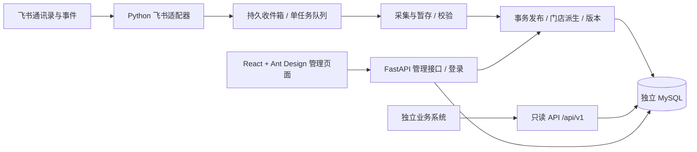

# 飞书组织架构维护系统：搭建计划与 UI 设计

日期：2026-09-15｜状态：待评审设计｜本轮交付：计划、页面原型及交互规范

## 1. 基线与技术决策

业务范围沿用根目录 `README.md`、`方案.md`、`同步与接口设计.md`、`决策与验收.md`。本次用户指定 Python + Ant Design，并进一步指定 MySQL；后端与数据库按最新要求执行，其余已确认业务规则继续有效。当前目录只有方案文档与原型，尚无应用代码，也不是 Git 仓库。

推荐 **FastAPI + React / TypeScript + Ant Design + MySQL**。Python 负责接口、权限、同步和派生计算；Ant Design 是 React 组件库，因此浏览器界面仍使用 TypeScript。前后端开发分离，生产统一域名、同一应用镜像交付。

| 路线 | 适用性与取舍 |
| --- | --- |
| FastAPI + React / Ant Design（推荐） | 直接表达现有 API 契约；组织树、表格和详情抽屉可自由组合；需要维护前后端两个构建工具链 |
| Django + React / Ant Design | 适合团队已熟悉 Django 的情况，管理与 ORM 能力完善；本项目仍需自建同步引擎和业务页面 |
| Python 页面框架包装 Ant Design | 可用于小型工具验证；本项目复杂树表交互、身份会话和查询契约需要更多包装适配，不作为首版路线 |

### 建议依赖与部署

- Python：FastAPI、Pydantic、SQLAlchemy、Alembic、PyMySQL、飞书官方 `lark-oapi` SDK。
- 浏览器：React、TypeScript、Vite、Ant Design、React Router；服务数据请求集中封装。
- 存储：独立 MySQL；收件箱、任务、定时触发去重均持久化；首版不引入 Redis。
- 测试：pytest 验证领域规则和 MySQL 事务；Playwright 验证关键页面流程。
- 交付：多阶段镜像先构建前端，再将静态资源打入 Python 镜像；Compose 启动应用与数据库。应用容器内监督 HTTP、事件接收、单任务 worker 进程，统一退出与健康检查。生产 HTTP 不启动额外 worker 副本触发重复任务；数据库租约与全局发布锁作为双重保护。
- 每日核对按 `Asia/Shanghai` 默认 03:00；定时记录用数据库唯一键去重，启动或连接恢复补全量核对。
- HTTPS 使用部署环境现有入口；部署手册给出反向代理、飞书回调地址、出网和持久卷配置。
- 版本在阶段 0 核验兼容性并提交 Python 与前端锁文件，不将未经验证的“最新版”写死为前提。

### MySQL 落地约束

- 建议采用 MySQL 8.4 系列，部署前核验并固定具体补丁版本；所有业务表使用 InnoDB、`utf8mb4`，时间统一以 UTC 存储、页面按北京时间展示。
- 使用 SQLAlchemy + PyMySQL 同步数据库会话与 Alembic 迁移；同步数据库操作放在同步处理器或受控线程中，不阻塞事件接收循环。
- 全局发布通过锁定 `dataset_state` 单例行（`SELECT ... FOR UPDATE`）串行化；门店修改与同步发布遵循同一锁顺序、同一事务，失败整笔回滚。远程采集不持有该锁。
- 单任务执行资格由数据库租约控制，任务认领使用短事务行锁；如使用 `SKIP LOCKED`，仅用于队列认领，不能用于组织业务查询。发布前核验租约代次，防止过期 worker 提交。
- 查询显式使用 InnoDB `REPEATABLE READ` 一致读事务，在同一快照中读取事实与版本；每页分别校验游标版本，跨页版本变化仍返回 409。
- 来源 ID、事件 ID 和凭据标识采用区分大小写的比较规则；门店编码去除首尾空白、空值转为 NULL，编码按区分大小写的规则唯一保留，前后端一致校验。历史编码使用独立保留表，避免依赖部分唯一索引。
- 补充死锁/锁等待的有界重试、唯一约束冲突、租约过期和一致读测试。数据库迁移单独执行，不把 DDL 放入业务发布事务。
- Compose、健康检查、持久卷及备份恢复手册统一面向 MySQL；在真实 MySQL 上验证一致性备份与恢复，恢复后更新 `dataset_epoch` 并全量核对。

实现参考：[MySQL 行锁与队列读取](https://dev.mysql.com/doc/refman/8.0/en/innodb-locking-reads.html)、[SQLAlchemy MySQL 驱动](https://docs.sqlalchemy.org/en/20/dialects/mysql.html)。上述为待开发验证的实现约束。

官方依据（2026-09-15 查询）：[Ant Design React](https://ant.design/docs/react/introduce/)、[FastAPI OpenAPI](https://fastapi.tiangolo.com/tutorial/first-steps/)、[飞书 Python 长连接实现](https://github.com/larksuite/oapi-sdk-python/blob/v2_main/lark_oapi/ws/client.py)。SDK 实现存在不代表目标企业权限和事件行为已通过联调。

## 2. 架构与模块边界

| 模块 | 职责 | 边界 |
| --- | --- | --- |
| identity | 飞书登录、会话、白名单、API 凭据 | 管理会话与机器只读凭据分开校验；姓名、工号不用于认证 |
| directory | 部门、员工、关系及状态查询 | 飞书来源字段只读；稳定本地 ID 不随名称改变 |
| stores | 标记、编码、备注、最近门店和主门店计算 | 非空编码唯一且历史保留；批量明确节点，不继承标记 |
| feishu | ID 规范化、分页、权限分类、事件解析 | 所有远程模型转换在此完成；不在页面猜测来源字段 |
| sync | 暂存、校验、排队、重试、事务发布 | 只更新飞书字段；采集期间允许本地门店修改 |
| audit | 记录来源、操作者、差异及提交时间 | 同业务变更一起提交，不承诺真实业务生效时间 |
| public_api | 一致读、版本游标、只读鉴权 | 版本变化返回 409；初始化未完成返回 503 |

沿用原设计的 13 类表对象；另外明确 `admin_session`（可撤销会话）、`store_code_reservation`（历史编码唯一保留）、`employee_store`（派生投影）。编码再次分配给其他部门时拒绝；同部门恢复原编码允许。部门/人员/关系/门店投影/日志/版本必须在同一事务内发布。只读响应从同一一致读事务获取数据及版本。

建议目录：`backend/app/{identity,directory,stores,feishu,sync,audit,public_api}`、`backend/migrations`、`backend/tests`、`frontend/src/{pages,components,services}`、`deploy`、`docs`。本轮不创建生产骨架。

## 3. 页面与交互规范

### 导航与视觉

左侧固定 208 px 导航，顶部 64 px 企业和账户区；内容区 24 px 间距。桌面以 1440×900 为基准，背景 `#F5F7FA`、白色内容卡、主色 `#1677FF`，正文 14 px，标题 24 px，圆角 8 px。状态均有文字，不单靠颜色。窄屏折叠菜单、树转抽屉、表格横向滚动；首版以桌面管理为主。

导航为组织架构、门店管理、同步中心、变更日志、管理设置。人员详情从组织和门店列表打开，不额外增加人员业务模块。所有原型的企业、人数、时间和身份均为虚构示例。

| 页面 | 核心布局 | 实施时 Ant Design 组件 |
| --- | --- | --- |
| 组织架构 | 左树右表；部门摘要；直属/全部下级切换；批量选择 | Layout、Menu、Tree、Input.Search、Descriptions、Segmented、Table、Tag、Modal |
| 门店管理 | 搜索与失效筛选；人员数与主门店人数分列；资料编辑 | Form、Input、Select、Checkbox、Table、Drawer、Alert |
| 人员详情 | 主部门、全部门店、主门店、两条归属路径 | Drawer、Descriptions、Tag、Timeline、Alert |
| 同步中心 | 连接/覆盖/最近成功；阶段、计数、任务列表及失败详情 | Card、Statistic、Badge、Steps、Table、Drawer、Alert |
| 变更日志 | 对象/操作/操作者/任务/时间筛选；前后差异 | Form、DatePicker.RangePicker、Table、Descriptions |
| 管理设置 | 飞书连接、白名单、API 客户端、核对时间 | Tabs、Form、Input.Password、Table、TimePicker、Modal |
| 登录及异常 | 飞书登录、无权限、初始化、空结果和服务异常 | Button、Result、Empty、Skeleton、Alert |

### 关键操作

1. **查看组织**：搜索部门 → 展开祖先定位 → 选择部门 → 默认直属人员，可切换全部下级（去重）→ 打开人员详情。虚拟公司根不允许设为门店。
2. **批量标记**：树复选框使用独立勾选语义 → 预览明确选中节点、受影响去重人数 → 确认提交 → 原子保存并重算 → 刷新版本。预览携带内容版本；提交前数据变化则要求重新预览，不沿用旧人数。取消标记弹窗说明资料保留及归属重算。
3. **资料编辑**：名称、路径、来源状态只读；仅编码和备注可写；编码重复显示字段错误；提交中防重复；失败保留输入。失效部门禁止新设门店。
4. **人员解释**：张三主部门为人民路店/后厨组，兼职大学城店，主门店为人民路店。总部主部门且兼职门店时，显示“无主门店：主部门不在门店下”；主标识缺失为“未知”；矛盾为“待核实”；已离职为“已失效”。
5. **同步任务**：全量直接提交后台任务；局部更新先确认自身、全部后代和人员范围。返回 202 后展示任务链接；重复提交展示复用或合并原因。未知总量只显示阶段、处理数量和耗时，完成后才给结果摘要。
6. **失败与陈旧**：覆盖不足展示警告；分页失败保留上一版；首次失败显示初始化未完成。离线不等于无事件；连接状态与最近事件时间分别显示。失败详情包含对象、阶段、脱敏原因与重试入口。
7. **安全设置**：密钥仅录入或轮换，已有密钥不回显。API 新凭据只展示一次并提示妥善保存，撤销确认后立即失效。会话撤销、登录 state 校验、Cookie 安全属性及管理写接口 CSRF 防护列入开发。
8. **日志**：默认显示发现/提交时间，详情显示修改前后、来源和任务关联；不提供“任意日期组织还原”按钮。

原型图为布局与业务语义样稿，并未加载真实 Ant Design 运行库或连接 API；实际组件属性须在实现前查阅 CLI/官方文档。

## 4. 搭建顺序与验收门槛

按一个熟悉该栈的开发者估算 22～30 个工作日；企业授权等待和部署环境准备不计入。实际组织规模未知，阶段 0 后更新估算。各阶段共同构成完整首版。

| 阶段 | 预计 | 具体交付 | 验收映射 |
| --- | --- | --- | --- |
| 0：工程核验与契约 | 2～3 天 | 核验 Python SDK 六类事件/长连接、全员与无部门人员枚举、orders 与身份 ID；记录真实规模；锁依赖、确定分页/错误结构 | 原验收文档开发核查项 1～9；产出脱敏联调记录 |
| 1：工程与身份底座 | 3～4 天 | FastAPI/React 工程、迁移、Compose、飞书登录、初始白名单、会话与权限边界；页面布局 | AC24～25；普通用户及机器凭据不能调用管理写接口 |
| 2：首次全量与组织查看 | 4～5 天 | 事件先入箱、完整分页、ID 归一化、暂存校验与发布、组织树和人员详情 | AC01～04、10～11、18、23；初始化失败不发布空组织 |
| 3：门店维护与派生 | 3～4 天 | 单个/批量标记、编码保留、备注、最近门店派生、解释路径、日志 | AC05～09、12～14、22；同版本事实/派生/日志一致 |
| 4：完整同步与故障恢复 | 5～7 天 | 子树、六类事件、每日核对、去重、乱序保护、退避重试、恢复和同步中心 | AC15～21、30～31；缺席或超时不造成错误失效 |
| 5：对外 API 与上线交付 | 5～7 天 | 8 个只读端点、版本游标、凭据轮换、日志查询、部署手册、备份恢复及整体验收 | AC26～29、32，并回归全部 AC01～32 |

身份防护在阶段 1 完成，避免把未授权的管理接口带入联调。只读契约在阶段 0 设计，阶段 5 完成对外使用与验收。

### 管理端接口补充草案

管理接口统一 `/admin/api`：部门/员工/门店 GET；门店 PATCH（仅本地字段）；门店批量 preview/apply POST（全有或全无）；同步任务 POST/GET；任务 retry POST；日志 GET；连接与覆盖状态 GET；白名单 GET/POST/DELETE；客户端 GET/POST、rotate/revoke POST；每日核对配置 PATCH。所有列表固定筛选白名单、稳定排序与分页；错误包含机器码、可读说明、字段错误和追踪 ID，不泄露密钥。

读 API 路径、状态码、世代和版本语义原样沿用 `同步与接口设计.md`。管理员页面遭遇版本冲突时刷新数据并解释原因；编辑未提交内容保留以便再次核对。

## 5. 验证与交付清单

- 领域测试：多部门去重、嵌套门店、总部兼职、缺失/矛盾主部门、取消标记、改名移动、编码保留。
- MySQL 集成测试：原子发布和回滚、门店并发修改、版本一致读、跨页 409、任务中断恢复；不以 SQLite 替代事务验收。
- 飞书适配测试：真实脱敏样本与可控故障，覆盖分页失败、权限收窄、重复乱序事件、移出子树保护；真实企业联调结果独立记录。
- 页面验证：树定位与独立勾选、人员范围切换、资料错误回显、详情解释、同步阶段与重试、白名单拒绝、凭据轮换；检查键盘焦点与桌面/窄屏布局。
- 部署演练：全新初始化、进程重启、数据库备份恢复（改变 epoch）、恢复后核对；测量全量耗时、事件提交延迟和队列积压，不预先承诺分钟级 SLA。
- 最终交付：源码、锁文件、迁移、Compose、环境变量样例、API 契约、运维手册和 AC01～32 的验证证据。

## 6. 原型索引

在 [原型图总览](./ui/index.html) 浏览六张桌面原型；SVG 文件可独立缩放查看。

1. [组织架构](./ui/01-organization.svg)
2. [人员详情](./ui/02-employee.svg)
3. [门店管理](./ui/03-stores.svg)
4. [同步中心](./ui/04-sync.svg)
5. [变更日志](./ui/05-audit.svg)
6. [管理设置](./ui/06-settings.svg)

本轮已授权范围为制定计划和绘制原型；下一步根据评审意见进入阶段 0 与工程搭建。
