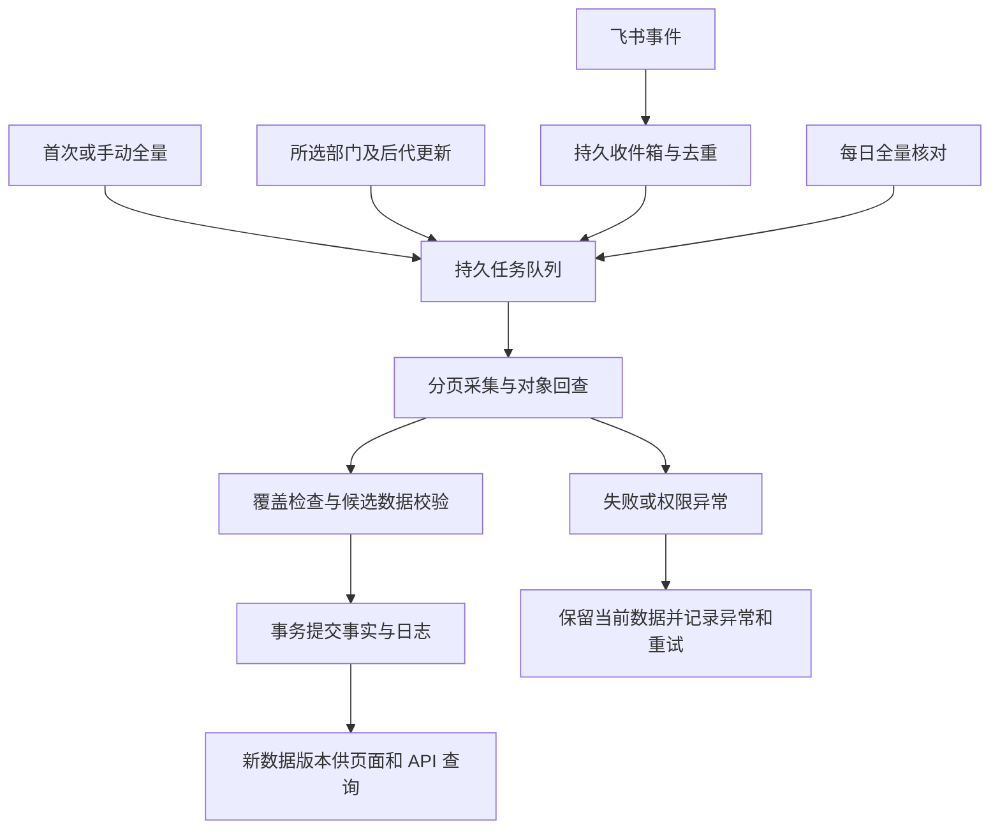

# 同步与接口设计

> v1.0 · 2026-09-14  
> 本文是首版实现建议，未提供生产代码或可执行数据库迁移。

## 1. 数据模型

采用独立 MySQL，内部稳定 ID 与飞书标识分离。应用只配置一个飞书组织，不建设租户管理；连接中记录实际组织身份作为防误接校验，不能直接换组织后把旧数据继续混用。

数据库按 2026-09-15 用户要求选用 MySQL，建议 8.4 系列、InnoDB 与 `utf8mb4`。发布使用单例状态行的事务行锁，读取使用显式一致读事务；驱动、队列租约、编码唯一性与恢复约束见[搭建计划](./docs/搭建计划.md#mysql-落地约束)。

| 对象/建议表 | 关键字段 | 约束和用途 |
| --- | --- | --- |
| `feishu_connection` | 实际组织标识、应用 ID、密钥引用、覆盖状态、最后连接状态 | 单一启用连接，密钥独立保护，不向查询 API 暴露 |
| `department` | `id`、`feishu_department_id`、`parent_id`、名称、来源状态、同步质量、`last_seen_at` | 飞书 ID 在实例内唯一；保留失效记录；祖先闭合且无环 |
| `employee` | `id`、`feishu_user_id`、同应用 `open_id`、姓名、可选工号、来源状态、同步质量 | 飞书用户标识唯一，工号和姓名不作为稳定身份依据 |
| `employee_department` | 员工 ID、部门 ID、`is_primary`、有效状态 | 同员工部门的有效关系唯一；有效且已核实的主部门至多一个 |
| `store_profile` | `department_id`、`is_store`、可选 `store_code`、备注 | 部门一对一；非空编码唯一，资料不被飞书同步覆盖 |
| `event_inbox` | `event_id`、类型、对象引用、接收时间、处理状态、尝试次数 | 事件去重、持久化接收、可重试；只留处理所需载荷 |
| `sync_job` | ID、类型、根部门、触发方、阶段、计数、错误、开始结束时间 | 持久化任务，支持进程重启后恢复或重新采集 |
| `sync_staging` | 任务 ID、对象标识、规范化数据、获取和覆盖信息 | 同步候选数据，完成校验后发布，失败不直接污染当前版本 |
| `change_log` | 对象、前后差异、来源、操作者、任务/事件引用、提交时间 | 部门、关系、门店和状态变更留痕，无任意时点快照承诺 |
| `dataset_state` | `dataset_epoch`、`data_version`、初始化状态、覆盖及最近成功时间 | 数据世代与全局内容版本，供读取方核对 |
| `admin_allowlist` / `api_client` | 管理员飞书身份；使用方名称、凭据哈希、启停状态 | 人的管理权限和服务的只读权限分开 |

`primary_department_id`、`store_ids`、`primary_store_id` 是规范化或派生的查询字段。首版可在查询时计算或维护内部投影；无论实现方式如何，都必须与部门树、主部门和门店标记属于同一已提交版本。

### 1.1 标识和来源规范

- 飞书部门接口统一选择一种部门 ID 类型，建议使用 `open_department_id`；字段仍可能名为 `department_id`，必须以请求参数及官方事件定义判断其语义。
- 通讯录人员统一选择 `user_id`；登录同时保存同一应用的 `open_id` 映射。跨应用的 `open_id` 不直接比较。
- `orders[].department_id`、用户部门列表、事件对象和部门详情统一归一到选定 ID 类型，不混用字符串外观相似的标识。
- 虚拟公司根节点用于展示和遍历，不作为真实门店或员工部门。根节点参数及授权要求在联调时核实。
- 相同来源稳定 ID 重新可读时复用本地 ID；不同来源 ID 即使名称、工号相同，也不自动合并。

### 1.2 业务状态与数据质量分开

业务状态表达有效、部门已删除或员工已离职；`sync_quality` 表达 `verified`、`stale`、`unknown` 或 `inconsistent`。

来源状态无法核实时，保留最后已知值并标记质量，不制造“在职”或“离职”结论。登录资格不能仅由工号、部门存在或未经核实的默认状态推断。

主门店结果建议同时返回 `primary_store_status`：

- `resolved`：已解析到门店。
- `not_in_store`：主部门和祖先完整可信，但没有门店。
- `unknown`：主部门标识或所需层级尚不可读。
- `inconsistent`：多个主部门或主部门不在其有效关系内，回查后仍矛盾。
- `inactive`：员工已明确失效，当前不再分配主门店。

## 2. 飞书接入能力

采用企业自建应用，完成通讯录字段权限、全员通讯录范围、六类事件及飞书登录相关配置。应用可用范围与通讯录读取范围不是同一设置，不可互相替代。

| 能力 | 接口/事件 |
| --- | --- |
| 子部门遍历 | Contact v3 部门子列表接口；组合所选部门本身与全部后代 |
| 部门人员 | Contact v3 `users/find_by_department`，按部门读取直属用户并处理每页 |
| 对象回查 | 部门详情、用户详情，处理事件、补齐主部门和核实移动 |
| 部门变化 | `contact.department.created_v3`、`contact.department.updated_v3`、`contact.department.deleted_v3` |
| 人员变化 | `contact.user.created_v3`、`contact.user.updated_v3`、`contact.user.deleted_v3` |
| 主部门 | `User.orders[].is_primary_dept` 及同条目的 `department_id` |

主部门只采用唯一明确主标识。列表未返回足够信息时回查用户详情；详情仍缺失、冲突或权限不明时标记异常。不能用 `department_ids[0]`、任意非空部门或本地排序补出主部门。

官方模型已验证可承载上述字段；实际组织权限下的返回完整性、主部门变化事件触发、分页和限流参数必须联调验证。来源链接及已核实边界见[官方依据](./决策与验收.md#4-官方依据与核查边界)。

## 3. 四种同步入口，共用一套处理流程



### 3.1 初始化和全量更新

1. 验证连接的真实组织身份和授权覆盖。先建立事件接收并持久化，再开始初始化，缩小初始化过程的变动遗漏窗口。
2. 从公司根开始，分页获取完整部门集合，补齐父节点；分页获取每个部门的直属人员，按飞书用户 ID 去重。
3. 获取用户完整部门关系、来源状态和主部门信息；列表字段不完整时补取详情。无部门人员若未被该遍历方式覆盖，应核查官方授权人员枚举能力并纳入；未解决前不能宣称全员覆盖完成。
4. 将结果放入暂存区，检查分页完成、授权范围、父子树闭合、关系有效性和主部门唯一性。字段异常可保留已知资料并报告，不能伪造全字段完整。
5. 对“上次有、本次没有”的对象单独核实。只有可靠生命周期证据才执行失效；无法区分删除和失去可见性时进入待核实。
6. 在事务中发布有效候选数据、关系变化和日志，递增内容版本。门店资料使用当前本地值，不能被采集开始时的旧快照覆盖。
7. 消费采集期间积累的事件，对相关对象回查最新事实；持续到队列恢复正常。不同接口分页不构成飞书端原子快照，必须依靠事件和后续核对持续收敛。

关键分页或范围采集失败时，本次全量不发布不完整组织快照、不清除缺席对象；任务失败并保留上一版。首次失败时 API 返回初始化未完成，不返回空列表伪装真实空组织。

### 3.2 指定父部门更新

更新范围是所选部门本身、全部后代部门，以及这些部门涉及的人员资料和关系。它是一次任务范围，不改变长期“全企业”同步范围。

- 同时检查本地原子树和本次新子树，识别已移入、移出或无法读取的节点。
- 部门移出子树时回查其最新详情与祖先链，将其移动到新位置；不能因为没出现在原父部门下就删除。
- 对本次涉及的员工回查完整部门关系；员工从此子树移走，只移除已确认结束的对应关系，不能据此判定全局离职。
- 对跨范围的新主部门、其他部门或父节点，补齐必要详情和祖先链，使主门店计算有据可查。这不代表要遍历新分支下所有员工。
- 对全局其他分支不做基于“本次未看到”的失效判断。
- 无法补齐必要上下文时保留当前版本或已知值并显示异常；必要时自动安排一次全量核对。

### 3.3 事件驱动更新

长连接由官方 SDK 管理。接收回调只校验、记录去重键、持久化必要载荷并尽快返回，远程回查交给后台；官方 SDK 文档要求回调在 3 秒内完成，不能在回调内跑整棵组织更新。

- 事件去重键优先使用官方事件 ID，重复投递不重复产生业务变更日志。
- 创建和更新事件触发权威回查，不直接用可能不完整或迟到的事件载荷覆盖当前记录。
- 删除和离职事件先验证来源并核对当前事实；对象仍有效则以当前详情为准。详情不可读且无法可靠排除权限变化时标记待核实，不让迟到事件覆盖已经恢复的对象。
- 通知不假定必达、有序或恰好一次。更新早于创建、重复、断线及服务重启均通过回查、幂等和全量校准处理。
- 同一对象的密集变化可合并回查，但不得把尚未处理的生命周期事件直接丢弃。
- 处理完成后才将收件箱标为已处理；失败保留错误与次数，按退避策略重试，并设上限后进入可见待处理列表。
- 长连接恢复和服务启动后安排全量核对，不依赖未经验证的飞书离线事件保留时长。

### 3.4 任务并发与发布

首版同一时间只执行一个组织同步任务，避免全量和子树写入竞争。相同范围的重复点击复用运行中的任务；全量能够覆盖排队中的同类核对，但必须保留可解释的合并结果。

管理端门店修改可以在远程采集期间提交。发布同步结果时获取短时数据库写锁，只更新飞书字段，基于最新门店设置重算派生结果。同步发布和门店变更各自事务化递增 `data_version`。

事务保证组织事实、关系、当前门店派生结果、变更日志和版本一致；失败全部回滚。纯重试或没有业务变化的同步不增加内容版本，只更新同步健康时间。任务进程异常中断后重新核查并重采未完成范围，不能把未提交结果标为成功。

## 4. 只读服务 API

采用 `/api/v1` 命名空间，下游凭据只允许访问公开读接口；管理员写接口放在独立的 `/admin/api`，使用飞书登录会话和白名单授权。

### 4.1 查询端点建议

| 方法与路径 | 用途与主要参数 |
| --- | --- |
| `GET /api/v1/status` | 初始化、覆盖、数据质量、数据版本、最近全量成功时间；不返回凭据或内部事件载荷 |
| `GET /api/v1/departments` | 部门分页，支持 `parent_id`、`root_id`、`include_descendants`、`include_inactive` |
| `GET /api/v1/departments/{id}` | 部门详情，已知失效对象返回记录及状态，未知标识才返回 404 |
| `GET /api/v1/employees` | 员工分页，支持部门、门店、`primary_store_id`、失效筛选 |
| `GET /api/v1/employees/{id}` | 员工详情、部门关系、主部门、全部门店、主门店及解析状态 |
| `GET /api/v1/stores` | 门店分页，支持状态筛选；稳定 ID 与其部门 ID 一致 |
| `GET /api/v1/stores/{id}` | 门店详情和有效状态；已取消标记的已知对象仍可解释其历史身份 |
| `GET /api/v1/stores/{id}/employees` | 门店人员分页；`membership=all` 为全部归属，`membership=primary` 仅主门店归属 |

组织树通过扁平部门列表中的 `parent_id` 构建，避免强制在一个响应中返回全部树和人员。名称搜索、状态筛选和排序字段由接口契约固定，不能任意传 SQL 排序表达式。

门店批量维护、一键全量、子树更新、任务查询、日志查询、白名单及 API 凭据管理属于管理端功能。同步提交返回 202 和 `job_id`，业务查询不承担触发同步职责。

### 4.2 员工响应示例

以下为本地 API 示例，ID 均为示意值，不是飞书真实响应：

```json
{
  "data": {
    "id": "emp_1024",
    "name": "张三",
    "employee_no": "E1024",
    "status": "active",
    "sync_quality": "verified",
    "department_ids": ["dep_kitchen_a", "dep_store_b"],
    "primary_department_id": "dep_kitchen_a",
    "store_ids": ["dep_store_a", "dep_store_b"],
    "primary_store_id": "dep_store_a",
    "primary_store_status": "resolved"
  },
  "meta": {
    "dataset_epoch": "epoch_example_1",
    "data_version": 42,
    "coverage_status": "complete",
    "last_full_sync_at": "2026-09-13T19:00:00Z"
  }
}
```

数组顺序不隐含主部门或主门店。默认查询过滤明确失效对象，但返回的数据质量仍可能为过期或未知；下游必须根据自己的业务要求处理质量，不把默认列表等同于权限授权结果。

### 4.3 版本、分页与下游核对

首版提供当前事实读取，暂不建设增量事件流。`data_version` 是本实例已提交内容的全局递增版本；`dataset_epoch` 区分新初始化或备份恢复的数据世代。下游以两者共同判断是否需要重新拉取。

1. 每个查询在数据库一致读事务中读取数据和版本。
2. 首页返回不透明游标，绑定筛选、排序、最后 ID、世代和内容版本。后续页校验同一版本。
3. 请求期间版本改变，返回 409 `DATASET_CHANGED`，调用方丢弃本次暂存分页并重试，不拼接新旧版本。跨部门、员工等多个端点的整轮拉取也需传递同一版本约束。
4. 不依赖无限保留旧快照；频繁变化可能造成整轮重试，应退避并选择低峰时段核对。这是首版简化分页的已知限制。
5. 下游需要全量镜像时，在自身暂存区分页拉取包含失效部门和人员的全集，使用部门 `is_store` 判定取消标记；完成一轮一致版本后再替换自身投影。主记录缺失或 HTTP 错误不能直接当作删除。
6. 对业务引用使用稳定本地 ID，名称、路径和工号只作属性。各下游保管业务发生时快照，本系统不承诺替下游重建过去事实。

已知失效记录继续可按 ID 查询。`include_inactive=true` 返回有效与失效对象；不提供物理删除接口。401 表示凭据失效，403 表示权限不符，429 表示限流，503 表示初始化未完成或当前无法提供可用版本。

## 5. 可观察性与实现验证重点

记录全量耗时、事件接收至提交延迟、待处理数量、失败重试数、权限覆盖异常、主部门异常数、API 错误率和数据库备份结果。飞书不可达与本系统 API 不可用应分开报告。

首版验证至少覆盖真实分页、多部门去重、唯一主部门解析、主门店重算、子树移出保护、权限收窄、重复和迟到事件、任务中断恢复、事务回滚以及跨页版本冲突。详见[验收场景](./决策与验收.md#3-验收场景)。
