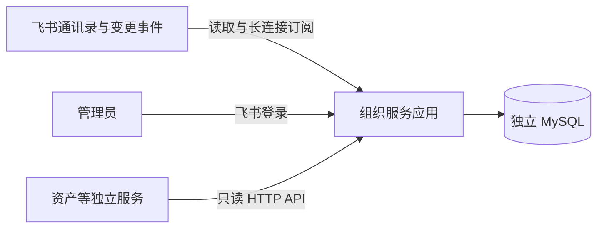

# 飞书组织架构维护系统建设方案

> v1.0 · 2026-09-14  
> 产品边界已在访谈中确认；技术选型和运行参数属于本方案建议，不代表已实现或通过实测。

## 1. 建设目标

先交付一个可以单独使用的组织架构维护系统，解决三个问题：管理员能看清飞书组织和人员，能指定哪些部门是门店，其他独立业务系统能取得统一的组织、人员和门店数据。

一个部署实例服务一家企业，只连接一个飞书组织。组织系统独立运行、独立存储、独立升级。未来资产、薪资或其他服务按实际需求逐个建设，通过 API 使用组织数据。

## 2. 首版范围

| 能力 | 首版交付 |
| --- | --- |
| 飞书接入 | 企业自建应用，配置凭据、通讯录权限和事件订阅，展示连接及同步健康状态 |
| 组织同步 | 拉取企业完整部门树、员工基础资料、多部门归属和主部门 |
| 组织查看 | 树形浏览、名称搜索、部门路径、直属与全部下级人员查看 |
| 门店维护 | 单个或批量设置、取消门店标记；维护可选门店编码与备注 |
| 人员门店 | 显示全部所属门店、主部门和由主部门派生的主门店 |
| 自动更新 | 接收部门和人员变化事件，异步回查并更新，每天全量核对 |
| 手动更新 | 一键全量更新；更新所选部门本身、所有后代及对应人员关系 |
| 同步中心 | 查看排队、执行进度、变更摘要、失败原因、最近成功时间和重试入口 |
| 历史查询 | 查看失效部门、离职记录、门店标记修改及组织关系变更日志 |
| 管理端登录 | 飞书登录，指定管理员白名单，无普通员工管理端入口 |
| 对外供数 | 独立 API 凭据、稳定本地标识、只读查询、分页、有效状态及数据版本 |
| 部署 | Docker Compose，单实例应用和独立 MySQL，备份与恢复说明 |

“完整组织”以实际获得的全员通讯录权限为前提。权限不足时必须显示覆盖不完整，不能把应用可见的一部分组织标为全企业已同步。

首版不包含租户开通与计费、多飞书组织、企业微信或钉钉、本地新增组织或员工、写回飞书、通用字段映射、门店经营资料系统、资产业务、跨系统权限中心、下游变更推送、任意日期组织快照还原和高可用集群。

## 3. 数据由谁维护

| 数据 | 权威来源 | 本系统操作 |
| --- | --- | --- |
| 部门名称、上级、人员姓名、工号、部门关系、主部门、来源状态 | 飞书 | 同步并只读展示；有误时到飞书修改 |
| 是否门店、门店编码、备注 | 本系统 | 管理员维护，不被同步覆盖 |
| 部门路径、所属门店、主门店、有效状态、数据版本、同步时间 | 系统计算 | 按规则生成，异常可见，不能手工伪造来源事实 |
| 各下游应用的角色、业务关系和历史单据 | 对应业务系统 | 本系统不存储、不审批、不改变 |

建议员工基础字段先包括姓名、可选工号、飞书标识、来源状态及部门关系。手机号、邮箱、证件、薪资等不作为首版同步必需字段；头像可作为展示增强，不阻塞核心同步。字段权限不足不应被解释为字段真实清空。

## 4. 门店和主门店规则

### 4.1 门店就是带标记的部门

- 一个部门节点最多对应一家门店，门店引用直接使用该部门的稳定本地 ID。
- 逐个设置，也可批量选择部门设置。选择父部门不意味着给全部后代打标。
- 门店标记没有继承性，门店下的“前厅组”“后厨组”仍是普通部门。
- 标记有效部门时，可填写门店编码和备注。建议非空编码在实例内唯一，历史已分配编码不自动回收；改码不改变稳定 ID，并记录日志。
- 取消门店标记后，部门仍存在；编码、备注和历史保留，当前门店列表不再返回它。
- 飞书部门改名或移动时，门店标记和资料跟随稳定部门 ID 保留。
- 同名新建部门不能自动继承旧门店标记或编码，需管理员重新设置。

### 4.2 员工所属门店

对员工每条有效部门关系，从该部门本身开始向上查找，遇到的第一个有效门店就是这条关系的门店；合并并去重，形成 `store_ids`。

允许同一员工属于多家门店。如果祖先和后代恰好都标为门店，按最近门店计算，不把同一条部门关系同时归给外层门店。页面应能显示归属路径以便解释。

### 4.3 主部门决定主门店

以飞书 `orders` 中唯一 `is_primary_dept=true` 的条目确定主部门，将其 `department_id` 规范化成本地 `primary_department_id`。`primary_department_id` 是本系统字段，不是飞书 User 的同名顶层字段。

从主部门本身开始向上找最近的有效门店，得到 `primary_store_id`。主门店是所属门店列表中的一项，但不是唯一所属门店。

| 情况 | 所属门店 | 主门店 |
| --- | --- | --- |
| 主部门是人民路店 | 人民路店 | 人民路店 |
| 主部门是人民路店下的后厨组 | 人民路店 | 人民路店 |
| 主部门是人民路店，另兼职大学城店 | 人民路店、大学城店 | 人民路店 |
| 主部门是总部运营部，兼职大学城店 | 大学城店 | 空，原因是主部门不属于门店 |
| 主部门标识缺失、多个主部门或关系矛盾 | 保留能确定的归属，并显示数据质量状态 | 空，标记待核实，不能取第一个部门或兼职门店代替 |
| 主部门或其祖先暂时不可读 | 返回已知信息及覆盖异常 | 空，标记未知，不误写成“无主门店” |
| 员工已离职 | 当前归属为空，历史可查 | 空，历史主门店可在日志查看 |

当主部门、部门上下级、员工部门关系或门店标记变化时，自动重新计算受影响人员的全部门店和主门店。不能只在首次导入时计算。

### 4.4 删除、离职和异常

可靠确认部门删除或员工离职后，将记录标记为失效，保留稳定 ID、最后资料和变更日志；当前部门关系结束，相关门店归属失效。

权限收窄、超时、分页失败、单次查不到、局部列表缺少某人，不等同于删除或离职。保留最后已知资料并标记待核实，恢复读取后再校准。

其他业务系统自行决定失效人员的资产移交或历史单据展示。组织系统不等待资产清理才反映飞书事实，也不级联修改下游业务数据。

## 5. 管理端页面

### 5.1 组织架构

左侧部门树，右侧部门资料与人员列表。支持部门名搜索、定位路径，切换直属人员和全部下级人员；人员列表按员工去重。

部门区展示飞书名称、上级、路径、来源状态、是否门店、最近同步时间。主要操作为“更新此部门及下级”“设为门店/取消门店”“编辑门店资料”。批量操作明确显示选中节点和受影响人员数量。

人员详情展示主部门、其他部门、所属门店、主门店、归属依据和异常原因。来源字段保持只读。

### 5.2 门店列表

展示门店名称、编码、组织路径、人员数量、主门店人员数量、备注和状态。人员数量按包含本门店的员工去重统计；一个跨店员工可以分别计入多家门店，不能用各店人数之和冒充企业总人数。

普通列表只显示有效门店，提供“包含失效记录”筛选。已取消标记的部门可通过组织页面和日志查看。

### 5.3 同步中心

展示连接、订阅、全员覆盖检查、最近事件处理、最近全量成功、当前任务和失败事项。事件很久未到不直接判定断线，连接健康与事件业务活跃度分别展示。

“一键全量更新”提交后台任务。“按部门更新”明确列出所选节点、包含全部后代和人员的范围。任务未完成时展示实际阶段及已处理数量，未知总量不显示虚构百分比。

失败详情可定位对象和阶段并重试。首次未完成全量时展示“初始化未完成”；已成功运行后发生故障时展示最后成功数据及其时间，不显示为实时一致。

### 5.4 管理设置与日志

管理设置包含飞书连接摘要、管理员白名单、只读 API 客户端和每日核对时间。密钥只录入或轮换，不返回明文已有值。

日志按对象、操作类型、操作者、任务和时间查询，记录实际发现和提交时间。来源未提供可靠业务发生时间时，不把发现时间描述成真实调岗生效时间。

## 6. 独立部署结构

应用内部包含管理页面、HTTP API、飞书适配器、任务执行和定时核对。建议队列直接持久化在 MySQL，单实例执行，首版不额外引入 Redis、Kafka 或服务注册中心。

按 2026-09-15 用户最新要求，采用 Python 后端与 React / Ant Design 前端，数据库采用 MySQL；具体实施建议见[搭建计划](./docs/搭建计划.md)。Docker Compose 将应用和数据库组合部署，不与未来资产系统共享业务数据库。本文不锁定依赖版本，开发时核验支持版本并固定依赖。

采用企业自建应用和长连接事件订阅。长连接不要求为事件接收暴露公网回调地址；管理员网页访问、飞书登录重定向地址和服务 API 仍需要各自可达、正确配置的 HTTPS 地址。服务器必须能够出网访问飞书。

首次部署通过受控配置指定初始管理员的飞书身份；不能让首个登录者自动成为管理员。管理员身份通过后端完成飞书授权校验，与同一应用身份标识映射，不能用姓名或工号冒充登录身份。

管理员每次访问需要有效会话及白名单资格；已确认离职的管理员撤销会话。最后一位管理员离职同样撤销访问，由部署维护者通过受控配置补设管理员并留痕，不因“最后管理员”保留离职账号。

## 7. 运行和恢复

- 每日全量核对建议默认北京时间 03:00，可配置。任务重叠时合并或排队，不并发覆盖。
- 分钟级是正常网络、权限及任务负载下的产品目标，非已验证 SLA。记录事件接收至数据提交耗时，异常和积压在同步中心可见。
- 首版单个同步任务执行；大规模全量任务可能增加事件等待时间。先测量，再决定是否按阶段让出执行机会，不预先建设分布式调度平台。
- 数据库使用持久卷。建议每天备份，配置与密钥独立保管，实施前完成一次恢复演练；恢复后重新全量核对飞书。
- 备份恢复或重新初始化时变更数据世代标识，使下游知道必须重新核对，不能把恢复后的旧版本误认为最新版本。
- API 凭据按使用方独立生成、哈希保存、可撤销和轮换；凭据不允许调用管理写接口。
- 历史从接入开始积累。首版不自动清理业务失效记录和变更日志；运行日志设轮转，后续按实际容量制定保留策略。

## 8. 分步交付与完成标准

| 阶段 | 可独立验收的结果 |
| --- | --- |
| 1. 飞书接入与组织底座 | 独立应用和数据库运行；完成全员范围检查、首次全量同步；页面能看部门、人员和主部门 |
| 2. 门店维护 | 单个/批量标记、编码备注、全部门店与主门店派生、归属解释和变更日志可用 |
| 3. 自动及手动同步 | 六类事件接入；全量、子树、每日核对、失败重试、失效保护和异常可见性可用 |
| 4. 对外使用与交付 | 飞书登录和管理员权限完整；只读 API、分页一致性、凭据轮换、Docker 部署和恢复验证完成 |

各阶段只是实施顺序，四个阶段共同构成已确认的首版。详细场景见[决策与验收](./决策与验收.md)，不以静态页面或一次成功导入代替完整验收。
